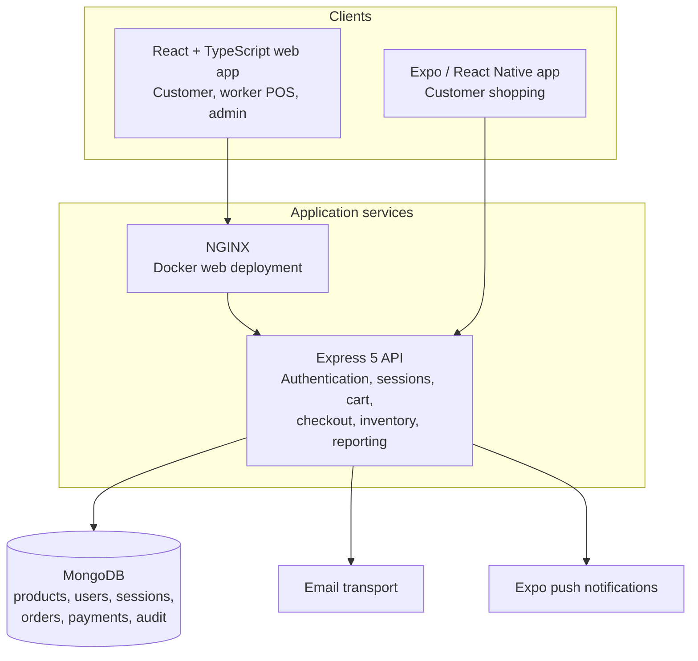

# Fresh Mart Self-Billing

Fresh Mart is a full-stack supermarket checkout and store-operations
application. It includes a React web client for customers, workers, and
administrators; a React Native/Expo customer app; an Express/TypeScript API; and
a MongoDB data store.

## Application map



## Main capabilities

- Customer registration, session QR joining, barcode scanning, cart review,
  receipts, and purchase history.
- Worker tools for issuing shopping sessions and confirming counter payments.
- Administrator tools for staff, stores, products/inventory, reports, and
  operational oversight.
- Server-side product and stock validation, order snapshots, tax calculation,
  and payment records.
- An Expo mobile client with camera scanning, secure token storage, deep links,
  and push-notification support.

## Run locally

Use Node.js compatible with the package manifests and install dependencies in
each application directory:

```powershell
cd backend
npm ci
npm run dev
```

In a second terminal:

```powershell
cd frontend
npm ci
npm run dev
```

The API listens on port `5000`; Vite prints the web URL when it starts. Configure
the backend with a local `backend/.env` file. See the
[deployment guide](./docs/07-deployment-and-operations-guide.md) for MongoDB,
Docker Compose, and mobile setup.

## Documentation

- [Full application report](./docs/PROJECT_REPORT.md)
- [Documentation index](./docs/README.md)
- [Deployment and operations](./docs/07-deployment-and-operations-guide.md)

## Safe local configuration

Never commit `.env` files or production credentials. For Docker Compose, copy
`.env.example` to `.env` and replace the placeholder with a unique random
`JWT_SECRET` before starting the stack. The root `.gitignore` excludes local
environment files, dependencies, and generated output.
