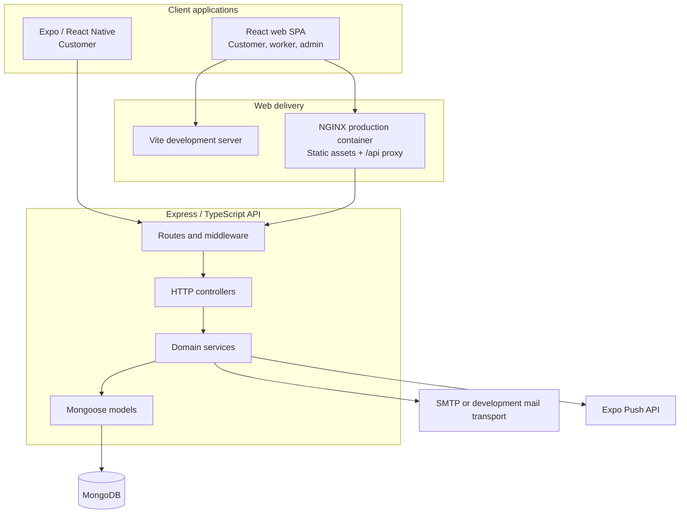
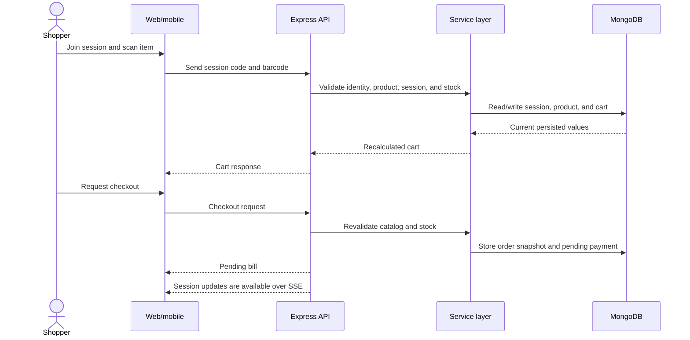

# System architecture

Fresh Mart is a multi-client retail system backed by one Express API and
MongoDB. The web and mobile apps are separate user experiences; the backend is
the authority for business state.

## Component view

## Responsibilities

| Layer | Responsibilities |
| --- | --- |
| Web client | Browser navigation, staff/admin pages, customer shopping, camera barcode capture, bill display and print |
| Mobile client | Customer sign-in, session QR joining, native camera scanning, cart, receipt, and history |
| API routes/controllers | HTTP mapping, request/response behavior, authentication and role middleware |
| Services | Session, catalog/cart, checkout, inventory, store, report, email, push, and vision workflows |
| Models | MongoDB schemas for users, products, sessions, carts, orders, payments, stores, and operational records |

## Request and checkout flow

## Deployment shape

Docker Compose runs MongoDB, the backend container, and an NGINX container that
serves the Vite build and proxies `/api/` to Express. The mobile app runs
separately and must be configured with an API address reachable from the
device. A local in-memory MongoDB fallback exists for demonstrations; it is
not durable storage. Session event streams and the nightly snapshot schedule
are process-local, so horizontal scaling requires shared coordination.

For a whole-system report, including data relationships, security and
limitations, see [PROJECT_REPORT.md](./PROJECT_REPORT.md).
