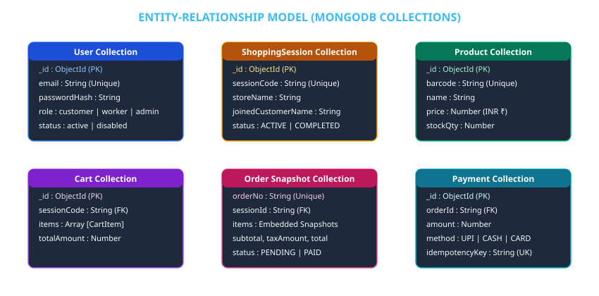

# 03 — Database & Entity Specification

## 1. Overview

The data persistence layer relies on **MongoDB** (with an automatic in-memory database fallback via `mongodb-memory-server` in `backend/src/config/db.ts`) managed via **Mongoose ODM**.

The database architecture balances document embedding for line-item sub-documents with explicit document referencing for independent entities (Users, Sessions, Orders).

---

## 2. Entity-Relationship Diagram (ERD)



---

## 3. Collection Specifications & Data Rules

### 3.1 `User` Collection
Stores user accounts for Customers, Workers, and Administrators under a single collection to avoid fragmented authentication models.

- **Unique Indexes**: `email` (lowercase, trimmed).
- **Security Rule**: `passwordHash` is excluded from standard `select()` queries.

---

### 3.2 `Product` Collection
Stores supermarket inventory items.

- **Unique Indexes**: `barcode` (trimmed).
- **Soft Deletion Policy**: Products are deactivated (`active: false`) rather than deleted from MongoDB. This guarantees that historical bills reference valid items without breaking query constraints.

---

### 3.3 `ShoppingSession` Collection
Manages session states for walk-in shoppers.

- **Unique Indexes**: `sessionCode`.
- **State Machine Values**: `ACTIVE` → `CHECKOUT_PENDING` → `COMPLETED` / `CANCELLED`.

---

### 3.4 `Order` Collection — Immutable Snapshot Strategy
When a customer checks out, an order document is generated. The `items` array embeds an **exact snapshot** of product details (barcode, product title, unit price, quantity, line total) at the time of purchase.

**Why Embedded Snapshots?**  
If a supermarket manager changes an item price (e.g. Milk from ₹65 to ₹70) or deactivates a product next month, past customer bills must preserve the original price paid (₹65). Embedded order snapshots decouple historical receipts from master inventory edits.

```typescript
const OrderSchema = new Schema<IOrder>({
  orderNo: { type: String, required: true, unique: true },
  sessionId: { type: String, required: true },
  customerName: { type: String, required: true },
  storeName: { type: String, required: true },
  items: [
    {
      productId: String,
      barcode: String,
      name: String,
      price: Number,
      unit: String,
      quantity: Number,
      lineTotal: Number,
    },
  ],
  subtotal: Number,
  taxAmount: Number,   // 5% GST Tax
  totalAmount: Number, // Subtotal + Tax
  status: { type: String, enum: ["PENDING", "PAID", "CANCELLED"], default: "PENDING" },
  paymentMethod: { type: String, enum: ["UPI", "CASH", "CARD"] },
  paidAt: Date,
});
```

---

### 3.5 `Payment` Collection
Stores payment status and idempotency keys to prevent duplicate transactions caused by network retries or accidental double clicks.

- **Unique Indexes**: `idempotencyKey` (sparse).
