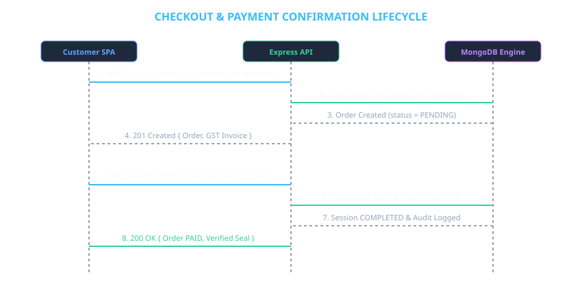

# 04 — REST API Interface Specification

## 1. Global API Standards

- **Base Endpoint**: `http://localhost:5000/api/v1`
- **Content Type**: `application/json`
- **Authentication**: JWT Cookie (`token`) or `Authorization: Bearer <token>`
- **Response Envelope**:
  ```json
  {
    "success": true,
    "message": "Optional operational response text",
    "data": { ... }
  }
  ```

---

## 2. Checkout & Payment Sequence Diagram



---

## 3. Endpoint Reference Matrix

| Domain | Method | Endpoint | Authorization | Description |
|---|---|---|---|---|
| **Auth** | `POST` | `/api/v1/auth/register` | Public | Customer self-registration |
| **Auth** | `POST` | `/api/v1/auth/login` | Public | User authentication & JWT cookie issuance |
| **Auth** | `POST` | `/api/v1/auth/logout` | Authenticated | Revoke JWT session token |
| **Auth** | `GET` | `/api/v1/auth/me` | Authenticated | Fetch active user profile |
| **Sessions** | `POST` | `/api/sessions` | Worker / Admin | Issue expiring shopping session QR |
| **Sessions** | `GET` | `/api/sessions` | Public / Worker | List active walk-in sessions |
| **Sessions** | `GET` | `/api/sessions/:code` | Public | Retrieve session details |
| **Sessions** | `PATCH` | `/api/sessions/:code/join` | Customer | Claim & join shopping session |
| **Products** | `GET` | `/api/products` | Public | List products (optional `?category=Dairy`) |
| **Products** | `GET` | `/api/products/barcode/:code` | Active Session | Product barcode lookup |
| **Products** | `POST` | `/api/products` | Admin | Create product in catalog |
| **Products** | `PATCH` | `/api/products/:id` | Admin | Update price, stock, or category |
| **Products** | `DELETE` | `/api/products/:id` | Admin | Soft-delete product |
| **Carts** | `GET` | `/api/carts/current?sessionCode=:code` | Active Session | Get active cart items & totals |
| **Carts** | `POST` | `/api/carts/current/items` | Active Session | Add product by barcode to cart |
| **Carts** | `PATCH` | `/api/carts/current/items/:productId` | Active Session | Update item quantity |
| **Carts** | `DELETE` | `/api/carts/current/items/:productId` | Active Session | Remove item from cart |
| **Checkout** | `POST` | `/api/v1/checkout` | Customer | Lock cart & generate order bill |
| **Checkout** | `POST` | `/api/v1/payments/confirm` | Worker / Counter | Confirm payment & deduct inventory stock |
| **Checkout** | `GET` | `/api/v1/orders` | Customer / Worker | List purchase order receipts |
| **Checkout** | `GET` | `/api/v1/orders/:id` | Owner / Admin | Fetch specific GST Tax Invoice receipt |
| **Workers** | `POST` | `/api/v1/workers` | Admin | Provision new worker account |
| **Workers** | `GET` | `/api/v1/workers` | Admin | List worker accounts |
| **Workers** | `PATCH` | `/api/v1/workers/:id/status` | Admin | Enable or disable worker status |
| **Admin** | `GET` | `/api/v1/admin/dashboard` | Admin | Revenue stats, stock alerts & audit trail |

---

## 4. API Request & Response Samples

### 4.1 Digital Checkout Execution (`POST /api/v1/checkout`)

**Request Payload**:
```json
{
  "sessionCode": "e3b0c442-98fc-4c8d-8e12-320098f98a21",
  "paymentMethod": "UPI"
}
```

**Response Payload (201 Created)**:
```json
{
  "success": true,
  "data": {
    "order": {
      "_id": "66d6a1b2c4e8f90012345678",
      "orderNo": "ORD-482910",
      "sessionId": "e3b0c442-98fc-4c8d-8e12-320098f98a21",
      "customerName": "Rahul Sharma",
      "storeName": "Fresh Mart Downtown",
      "items": [
        {
          "productId": "66d6a001c4e8f90011111111",
          "barcode": "8901",
          "name": "Amul Taaza Homogenised Toned Milk",
          "price": 65.00,
          "unit": "1 Litre",
          "quantity": 2,
          "lineTotal": 130.00
        }
      ],
      "subtotal": 130.00,
      "taxAmount": 6.50,
      "totalAmount": 136.50,
      "status": "PENDING"
    },
    "payment": {
      "orderId": "66d6a1b2c4e8f90012345678",
      "amount": 136.50,
      "method": "UPI",
      "status": "PENDING"
    }
  }
}
```
