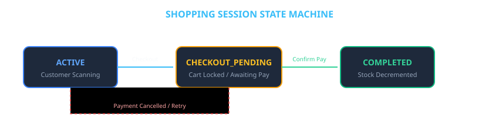

# 06 — System Workflows & Operational Dashboards

## 1. Overview

The platform coordinates real-time interaction across 5 specialized domain views, catering to all 3 system actors: **Workers**, **Customers**, and **Administrators**.

---

## 2. Session Lifecycle State Machine

---

## 3. Operational Dashboard Specifications

### 3.1 Worker POS Terminal (`pages/WorkerDashboardPage.tsx`)
- **Active Walk-In Sessions Table**: Real-time table displaying session tokens, outlet names, linked customer names, status badges (`ACTIVE`, `CHECKOUT_PENDING`, `COMPLETED`), and creation timestamps.
- **Counter Payment Confirmation**: View pending customer bills and confirm cash or UPI payments to transactionally update inventory stock.
- **Session QR Generator**: 1-click QR session token generation.

---

### 3.2 Customer Check-In Pass (`pages/JoinSessionPage.tsx`)
- **3-Step Visual Tracker**: Step 1 (Scan QR) → Step 2 (Customer Name) → Step 3 (Start Billing).
- **Name Check-In Form**: Validates customer name and updates MongoDB session document.

---

### 3.3 Active Cart & Live Camera Scanner (`pages/ShoppingPage.tsx` & `CameraScanner.tsx`)
- **ZXing Camera Barcode Reader**: Real-time video barcode reader (`@zxing/browser`) with viewfinder laser frame and audio scan chime.
- **Catalog Search & Filter Pills**: Filter items by categories (`Dairy`, `Bakery`, `Produce`, `Beverages`, `Snacks`, `Pantry`).
- **Live Cart Stepper**: Real-time stock limit guards, item quantity increment/decrement, item deletion, and automated **5% GST tax calculation** in **₹ (INR)**.

---

### 3.4 Digital GST Tax Invoice Receipt Modal (`components/DigitalBillModal.tsx`)
- **Official GST Invoice**: Itemized table, subtotal, 5% GST tax, total amount in **₹**, store GSTIN, timestamp, and payment status seal.
- **Print Support**: Native browser print formatting (`@media print`) for thermal receipt printing.

---

### 3.5 Customer Purchase History (`pages/CustomerHistoryPage.tsx`)
- **Digital Receipt Archive**: Search and view all past orders with status chips (`PAID`, `PENDING`), timestamps, and total amounts.
- **Historical Bill Inspector**: Inspect and reprint official tax receipts for any past transaction.

---

### 3.6 Admin Executive Dashboard (`pages/AdminDashboardPage.tsx`)
- **Executive Store Metrics**: Store revenue (₹), completed order volume, active sessions, catalog product count, and critical low stock warnings (≤ 5 items).
- **Worker Management**: Provision worker accounts with temporary passwords and toggle account status (`ACTIVE` / `DISABLED`).
- **Inventory Catalog CRUD**: Add new products, update prices/stock, and deactivate items.
- **Security Audit Logs**: Searchable operational audit trail logging all administrative actions.
