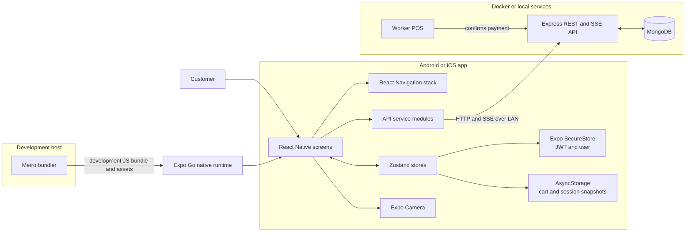
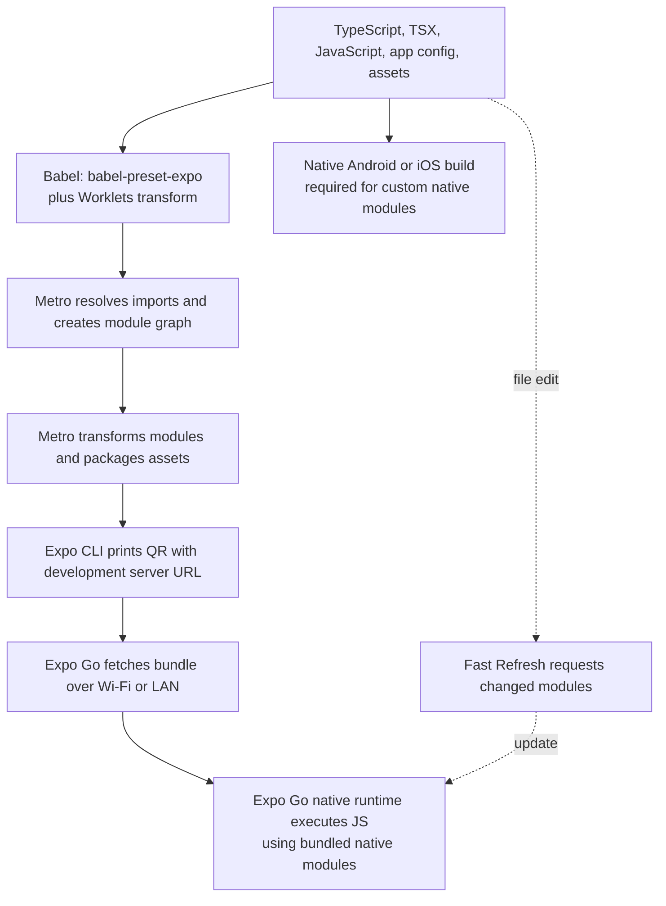
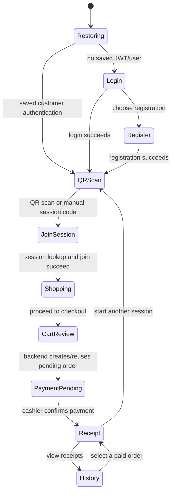
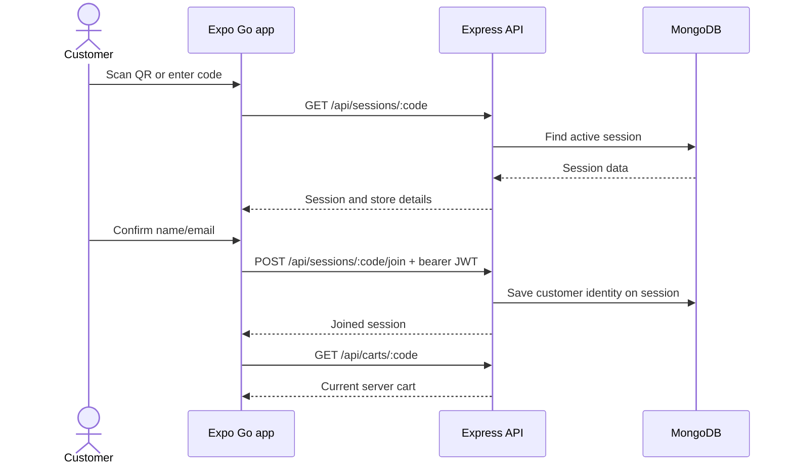

# Fresh Mart Mobile Application Guide

## 1. Purpose and current status

The customer app in `mobile/` is a React Native client of the Fresh Mart Express API. It lets a signed-in customer join a worker-created shopping session, scan products, review a cart, wait for cashier confirmation, view a receipt, and revisit paid orders.

The current stack is Expo SDK 57.0.30, React Native 0.86.3, React 19.2.3, TypeScript 6, React Navigation 7, Zustand 5, Axios, Expo Camera, Expo SecureStore, and AsyncStorage. The exact package versions are recorded in [mobile/package.json](../mobile/package.json) and [mobile/package-lock.json](../mobile/package-lock.json).

Expo Go is the current development runtime. It can run this app's JavaScript and the native modules bundled into the matching Expo Go SDK. Some native notification functionality requires a custom development build and is deliberately skipped in Expo Go.

## 2. Application architecture

The mobile app does not have a separate backend. Screen components call service modules; those services call the existing Express endpoints; backend controllers and services persist sessions, carts, orders, and payments in MongoDB.



### Source layout

| Path | Responsibility |
|---|---|
| [mobile/index.js](../mobile/index.js) | Registers the React root component with Expo. |
| [mobile/App.tsx](../mobile/App.tsx) | Root component, status bar, and notification handler setup for non-Expo-Go native builds. |
| [mobile/app.json](../mobile/app.json) | Expo app identity, scheme, icon/splash assets, Android/iOS settings, and camera plugin. |
| [mobile/babel.config.js](../mobile/babel.config.js) | Expo Babel preset and React Native Worklets plugin. |
| [mobile/src/navigation/RootNavigator.tsx](../mobile/src/navigation/RootNavigator.tsx) | Authentication-aware stack and `freshmart://join/:code` linking configuration. |
| [mobile/src/screens/](../mobile/src/screens) | Splash, auth, QR scan, session join, shopping, checkout, payment pending, receipt, and history screens. |
| [mobile/src/services/api.ts](../mobile/src/services/api.ts) | API base URL selection, Axios client, bearer token injection, and response errors. |
| [mobile/src/services/](../mobile/src/services) | Auth, session, cart, checkout, vision, and push API calls. |
| [mobile/src/store/](../mobile/src/store) | Zustand authentication, cart, and session state. |
| [mobile/src/types/index.ts](../mobile/src/types/index.ts) | Shared mobile-facing user, session, cart, order, and navigation types. |

The active root navigator is a stack. Although the bottom-tabs package and a tab-param type exist, the app does not currently mount a bottom-tab navigator.

## 3. Expo Go and JavaScript bundling

Expo Go is a prebuilt native host application. Metro serves the project's JavaScript bundle and referenced assets to Expo Go; Metro does not compile this project into an APK/IPA, and Expo Go does not download native source code from this repository.



At runtime, Expo Go supplies the native React Native and Expo SDK modules; the Metro bundle supplies the app's JS logic and assets. The SDK versions must be compatible: Expo Go's native runtime and the app's Expo SDK must agree. This project was migrated from SDK 52 to SDK 57 to match the installed SDK 57 Expo Go.

Use a development build instead of Expo Go when testing a native module not included in Expo Go, changing native configuration that Expo Go does not support, or preparing an app for store distribution. A JS bundle cannot add a new native module to the Expo Go binary.

### Start on Android Expo Go

From PowerShell:

```powershell
cd C:\temp\React\superMarket_SBilling\mobile
npm ci
npx expo install --check
npx expo start --lan --clear
```

Keep Metro running, open Expo Go on the phone, and scan the newly printed QR code. The phone and development computer must be on a network that allows device-to-host connections. Scan a fresh QR after restarting Metro; an old QR may refer to a stopped server or an old bundle. Press `Ctrl+C` in the Metro terminal to stop it.

`npm start` runs the same Expo CLI with default networking selection. `--lan` is useful for a physical phone on the same local network; `--clear` resets Metro's transform cache after dependency/configuration changes.

### How SDK matching works

1. `expo` selects the Expo SDK release.
2. `npx expo install --check` validates Expo modules and React Native packages against that SDK's compatibility map.
3. `expo-camera`, `expo-notifications`, and other Expo packages expose JS APIs that call native modules.
4. Expo Go contains a fixed set of native implementations. An absent native implementation cannot be supplied by refreshing the JavaScript bundle.
5. `expo-notifications` warns that its functionality is limited in Expo Go. This app skips notification setup and token registration there; use a compatible development build for full push testing.

## 4. Configuration and API connectivity

### API host selection

[mobile/src/services/api.ts](../mobile/src/services/api.ts) selects the backend base URL as follows:

1. If `EXPO_PUBLIC_API_URL` is set, use it as the configured backend origin or API base.
2. Otherwise use `Constants.expoConfig.hostUri` to find the Expo development host, then connect to that host on port `5000`.
3. If no Expo host is available, fall back to `http://localhost:5000/api`.

The URL normalizer ensures exactly one `/api` prefix. Example override for a physical device:

```dotenv
EXPO_PUBLIC_API_URL=http://192.168.1.15:5000
```

The `EXPO_PUBLIC_` value is compiled into the client bundle and must never contain a secret. Restart Metro after changing it. The port and host in the example are machine/network-specific; substitute the computer's current LAN address.

For a physical phone, `localhost` means the phone. The phone therefore needs the development computer's LAN IP, either inferred from the Metro host URI or set explicitly. The backend must listen on port 5000 on an address reachable from the phone. With Docker Compose, port `5000` is published from the backend container to the host.

`api.ts` attaches the SecureStore JWT in an `Authorization` bearer header, applies a 15-second request timeout, and translates server errors. For HTTP 404s it includes the method and full URL to help distinguish a wrong path from a wrong host.

Check backend reachability from the development computer:

```powershell
Invoke-WebRequest http://localhost:5000/api/health
```

For a device test, substitute the computer's LAN IP. If the computer can reach the API but the phone cannot, check that both are on the same network and that the host firewall permits inbound TCP port 5000.

## 5. Navigation and user journey

The root component renders `RootNavigator`. The navigator always mounts `NavigationContainer`; while authentication is being restored it renders Splash as a stack screen within that container. This is important because Splash uses application initialization and must not call navigation hooks outside navigation context.



### Authentication and session join

- Login and registration call `/api/v1/auth/login` and `/api/v1/auth/register`.
- The returned user and JWT are persisted with Expo SecureStore.
- Every Axios request reads the token from SecureStore and adds a bearer header.
- Expo Go does not register push tokens. A native development build attempts permission/token registration after login or registration.
- QRScan uses Expo Camera for QR codes and also supports manual entry of a session code.
- JoinSession loads the session, requests the customer's name/email, and sends an authenticated join request. The backend associates the session with the customer's account so resulting orders can be attributed to that user.



The worker dashboard creates the session and QR code; mobile joins an existing session. Joining is not the same as `POST /api/sessions/`, which creates a new worker session. Mobile join uses a code in the URL and the path ends in `/join`.

## 6. Shopping, checkout, payment, and receipt

### Product scanning and cart

`ShoppingScreen` uses Expo Camera to read supported barcode formats and applies a short duplicate-scan cooldown. It also offers manual barcode entry, quantity increment/decrement, removal, subtotal, and GST display. Cart mutations call the backend; the backend is authoritative for product, price, quantity, and totals.

`visionApi.ts` contains multipart image upload support for `/api/v1/vision/decode`. The current ShoppingScreen does not invoke that service as an automatic fallback after an unsuccessful camera scan; document this as a service capability, not an active scanner behavior.

Cart and session snapshots are stored in AsyncStorage. The cart store also contains pending-mutation queue helpers, but the shopping screen currently sends its mutations directly and does not wire a NetInfo reconnect listener to replay that queue. Offline cart mutation replay is therefore not a completed feature.

### Checkout and cashier confirmation

```mermaid
sequenceDiagram
  actor Customer
  participant App as Mobile app
  participant API as Express API
  participant DB as MongoDB
  participant Worker as Worker POS
  Customer->>App: Select UPI, Cash, or Card
  App->>API: POST /api/v1/checkout {sessionCode,paymentMethod}
  API->>DB: Validate session/cart, calculate totals, create or reuse pending order
  API-->>App: Pending order and payment
  API-->>App: SSE CHECKOUT_PENDING
  App->>API: GET /api/sessions/:code/stream
  Worker->>API: POST /api/v1/payments/confirm {orderId}
  API->>DB: Mark order/payment paid; complete session
  API-->>App: SSE PAYMENT_CONFIRMED
  App->>App: Clear cart/session, brief success screen
  App->>API: GET /api/v1/orders/:orderId
  API-->>App: Paid order
  App-->>Customer: Receipt screen
```

UPI/Cash/Card selection records the intended method; this flow does not charge a card, invoke a UPI SDK, or process a payment-provider transaction. The worker confirms receipt of payment at the POS. The backend broadcasts `PAYMENT_CONFIRMED` over the session SSE stream. `PaymentPendingScreen` reads the stream, clears local cart/session state, then replaces itself with Receipt. Receipt fetches the order from the API; History requests the customer's paid orders.

## 7. Mobile API reference

All paths below are relative to `API_BASE_URL`, which ends in `/api`.

| Mobile operation | Method and path | Purpose |
|---|---|---|
| Register | `POST /api/v1/auth/register` | Create a customer and receive JWT/user data. |
| Login | `POST /api/v1/auth/login` | Authenticate and receive JWT/user data. |
| Read session | `GET /api/sessions/:code` | Load store/session details from QR/manual code. |
| Join session | `POST /api/sessions/:code/join` | Associate authenticated customer name/email/account. |
| Load cart | `GET /api/carts/:sessionCode` | Fetch server cart. |
| Add item | `POST /api/carts/:sessionCode/items` | Add barcode and quantity. |
| Change quantity | `PATCH /api/carts/:sessionCode/items/:productId` | Update an item quantity. |
| Remove item | `DELETE /api/carts/:sessionCode/items/:productId` | Remove an item. |
| Create/reuse checkout | `POST /api/v1/checkout` | Create a pending order and payment record. |
| Await cashier event | `GET /api/sessions/:code/stream` | Listen for session/payment SSE events. |
| Confirm payment | `POST /api/v1/payments/confirm` | Worker POS operation; not called by the customer app. |
| Get receipt | `GET /api/v1/orders/:id` | Fetch an order for Receipt. |
| Purchase history | `GET /api/v1/orders/mine` | List paid orders for the signed-in customer. |
| Barcode image decode | `POST /api/v1/vision/decode` | Vision API service exists; automatic scan fallback is not wired into ShoppingScreen. |
| Register push token | `POST /api/v1/push/register` | Attempted only in a compatible native build. |

Session routes use `/api/sessions`; versioned auth, checkout, order, vision, and push routes use `/api/v1`. The API base already contains `/api`, so service paths must not add an extra `/api` prefix.

### Purchase history association

New mobile session joins send the customer's authenticated user ID to the backend. Checkout persists that ID on the order. The history endpoint filters paid orders by customer ID and also by the account email to include older orders created before customer IDs were attached. This email fallback is for compatibility with legacy records; new orders should be linked by ID.

## 8. State and persistence

| Store | Persistence | Notes |
|---|---|---|
| `authStore` | SecureStore keys `auth_token` and `auth_user` | Restored at launch; the backend remains responsible for validating token expiry. |
| `cartStore` | AsyncStorage cart snapshot and pending-mutation queue | Current screen actions use the API synchronously; queued offline mutations are not automatically replayed yet. |
| `sessionStore` | AsyncStorage `active_session` | Restores only `ACTIVE` or `CHECKOUT_PENDING` sessions. |

SecureStore is used for credentials; AsyncStorage is used for non-secret UI/session/cart data. Clearing cart/session after payment removes their local persisted values.

## 9. Push notifications and Expo Go limits

The app dynamically imports `expo-notifications` only outside Expo Go. `registerPushToken()` exits early in Expo Go because notification functionality and native topic subscriptions are not fully available there. The backend has push-token storage and notification dispatch code, but this does not make native push delivery available inside Expo Go.

To test push delivery, create and install a development build containing the matching Expo SDK and notification native module, configure Android FCM or iOS APNs credentials, and validate using a physical device. Metro reloads cannot add native modules to an installed Expo Go binary.

## 10. Dependencies and upgrades

Install packages through Expo's compatibility-aware tooling:

```powershell
cd C:\temp\React\superMarket_SBilling\mobile
npx expo install <expo-or-native-package>
npx expo install --check
npm run typecheck
```

Do not independently upgrade Expo, React Native, or Expo native modules without checking Expo's SDK compatibility map. After a coordinated SDK change, update the manifest/lockfile together, install the package set, run the dependency check and typecheck, start Metro with a cleared cache, and build the platform bundle.

Important configuration details:

- `babel.config.js` uses `babel-preset-expo` and `react-native-worklets/plugin`, required by the installed Reanimated 4 release.
- `tsconfig.json` extends `expo/tsconfig.base`, enables strict typing, and maps `@/*` to `src/*`.
- `app.json` references `assets/icon.png`, `assets/adaptive-icon.png`, `assets/splash.png`, and `assets/favicon.png`; keep those files in sync with config.
- `expo-camera` is configured with a camera-permission message in the Expo plugin.

## 11. Verification and troubleshooting

Run the following after changing mobile code or configuration:

```powershell
cd C:\temp\React\superMarket_SBilling\mobile
npx expo install --check
npm run typecheck
npx expo start --lan --clear
```

For a bundle-level check, open the Metro Android development bundle URL shown by Expo or request `/index.bundle?platform=android&dev=true&minify=false` from the local Metro server. A successful HTTP response verifies bundling, but does not replace testing the app on the target device.

| Symptom | Checks |
|---|---|
| Expo Go says project is incompatible | Confirm SDK with `npx expo config --type public`; run `npx expo install --check`; install Expo Go matching the SDK or upgrade the app and Expo modules as one supported set. |
| Phone cannot reach API | Use `--lan`; confirm same Wi-Fi; use the computer's LAN IP (not phone `localhost`); check `/api/health`; permit inbound port 5000 through the host firewall. |
| `API route not found` | Read the method and URL in the error. Join should be `GET /api/sessions/:code`, followed by `POST /api/sessions/:code/join`; session creation `POST /api/sessions/` belongs to the worker. |
| Asset cannot be resolved | Confirm each path in `app.json` points to a checked-in image under `mobile/assets/`; restart using `--clear`. |
| Navigation object not found | Ensure screens using navigation hooks are rendered under `NavigationContainer`; Splash must stay inside the stack while auth restores. |
| Notification native module missing | Expected limitation in Expo Go for unsupported native notification APIs; test in a development build. |
| Receipt redirect does not occur | Confirm the backend marked the order paid and published `PAYMENT_CONFIRMED` for the same session code; reload the updated Metro bundle. |
| History appears empty after an older payment | Refresh history and confirm the signed-in account email matches the email on the paid order; new orders are associated by customer ID. |

## 12. Current limitations and next work

- Add automated mobile tests for navigation/auth restoration, API host selection, QR/manual join, checkout, SSE confirmation, and history display.
- Implement and test the pending cart-mutation queue with connectivity monitoring and defined replay/conflict behavior.
- Connect the Vision API service to an explicit camera-capture fallback UX if required.
- Test SSE behavior across real Android/iOS devices, backgrounding, network loss, reconnection, and server restarts.
- Build/test native notification development builds with actual FCM/APNs credentials.
- The mobile UI currently uses a React Navigation stack, not bottom tabs; align unused navigation dependencies/types if tabs are added later.
- The POS confirmation is the payment authority. A real payment gateway integration is separate work.
