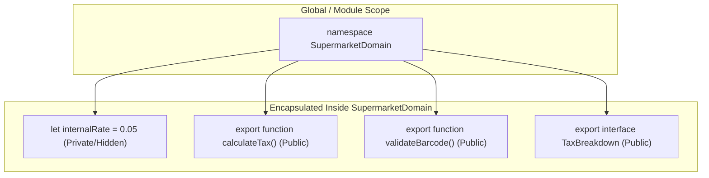
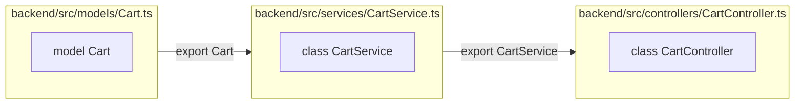
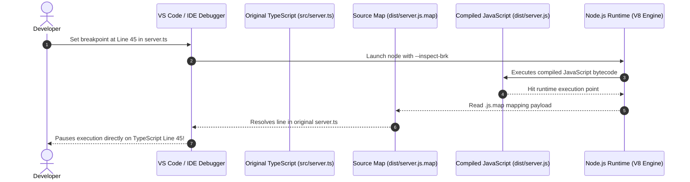
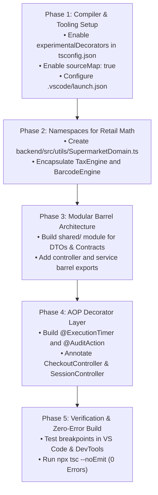

# Advanced TypeScript Engineering Guide
## Namespaces, Modules, Decorators & Source Map Debugging

---

### Cover Page & Document Preliminaries

#### Document Title
**Advanced TypeScript Architecture & Engineering Guide: Deep Dive into Namespaces, Modules, Decorators, and Source Map Debugging**

#### Application Context
**Fresh Mart Supermarket Self-Billing Platform (Full-Stack MERN + TypeScript)**

#### Target Audience
Software Engineers, Full-Stack Architects, and Computer Science Evaluators

#### Document Scope
A comprehensive, academically sound, and enterprise-grade exploration of four core TypeScript paradigms. Includes deep language semantics, runtime transpilation mechanics, design patterns, and an actionable architectural integration plan for the Fresh Mart retail platform.

---

### Executive Overview

TypeScript is designed as a typed superset of JavaScript, offering static typing, interface contracts, and modern ECMAScript features. However, unlocking its full architectural power requires mastering advanced meta-programming and code-organization paradigms:

1. **Namespaces**: Scoped internal containers for domain calculations, algorithms, and declaration merging.
2. **Modules**: Standardized external file units (ES Modules) governing dependency graphs, code isolation, and tree-shaking.
3. **Decorators**: Metaprogramming constructs enabling Aspect-Oriented Programming (AOP) for cross-cutting concerns (auditing, caching, execution timing, input validation).
4. **Debugging with Source Maps**: The mechanism connecting generated runtime JavaScript back to original TypeScript source code for breakpoint inspection and stack trace resolution.

This guide explores each concept theoretically, analyzes its compilation output, and outlines how each feature directly enhances the Fresh Mart Supermarket codebase.

---

<div class="page-break"></div>

## Chapter 1: Namespaces (Internal Scope Organization)

### 1.1 What is a Namespace?
A **Namespace** (historically termed an *Internal Module* in TypeScript versions prior to 1.5) is a TypeScript language construct used to group related functions, interfaces, types, and variables under a single named object scope.




### 1.2 Encapsulation and Access Rules
- **Information Hiding**: Any variable, function, or class defined inside a namespace is **private by default**. It cannot be invoked outside the namespace unless explicitly marked with the `export` keyword.
- **Avoiding Identifier Collisions**: Namespaces create distinct boundary scopes. Multiple domains can define identical function names (e.g., `Tax.calculate()` vs. `Discount.calculate()`) without collision.
- **Hierarchy & Nesting**: Namespaces can be nested indefinitely to reflect deep domain models (e.g., `FreshMart.Retail.Billing.Tax`).

### 1.3 JavaScript Compilation Mechanics (The IIFE Pattern)
Browsers and Node.js have no native concept of a `namespace`. Therefore, the TypeScript compiler (`tsc`) transpiles a namespace into an **Immediately Invoked Function Expression (IIFE)** attached to a JavaScript object:

#### TypeScript Source:
```typescript
namespace TaxCalculator {
  const GST_RATE = 0.05;

  export function computeTax(amount: number): number {
    return amount * GST_RATE;
  }
}
```

#### Transpiled JavaScript Output:
```javascript
"use strict";
var TaxCalculator;
(function (TaxCalculator) {
    var GST_RATE = 0.05;
    function computeTax(amount) {
        return amount * GST_RATE;
    }
    TaxCalculator.computeTax = computeTax;
})(TaxCalculator || (TaxCalculator = {}));
```

**Architectural Insight**: The expression `TaxCalculator || (TaxCalculator = {})` ensures that namespaces can span across multiple files. If `TaxCalculator` is already defined, new exported properties are appended to the existing object without overwriting it.

---

### 1.4 Supermarket Project Integration: `SupermarketDomain.ts`

In the Fresh Mart project, retail math (such as 5% GST calculation, CGST/SGST tax splitting, and barcode checksum verification) can be organized into a dedicated domain namespace:

```typescript
// backend/src/utils/SupermarketDomain.ts
export namespace SupermarketDomain {

  // 1. Tax Calculation Engine
  export namespace TaxEngine {
    const DEFAULT_GST_RATE = 0.05; // 5% GST

    export interface TaxBreakdown {
      subtotal: number;
      cgst: number;      // Central GST (2.5%)
      sgst: number;      // State GST (2.5%)
      taxAmount: number; // Total GST (5.0%)
      totalAmount: number;
    }

    export function calculateTax(subtotal: number, rate: number = DEFAULT_GST_RATE): TaxBreakdown {
      const taxAmount = Number((subtotal * rate).toFixed(2));
      const cgst = Number((taxAmount / 2).toFixed(2));
      const sgst = Number((taxAmount / 2).toFixed(2));
      const totalAmount = Number((subtotal + taxAmount).toFixed(2));

      return { subtotal, cgst, sgst, taxAmount, totalAmount };
    }
  }

  // 2. Barcode Validation Engine
  export namespace BarcodeEngine {
    export function isValidFormat(barcode: string): boolean {
      if (!barcode || typeof barcode !== "string") return false;
      const clean = barcode.trim();
      return /^[0-9]{4,14}$/.test(clean);
    }

    export function format(barcode: string): string {
      return barcode.trim();
    }
  }
}
```

---

<div class="page-break"></div>

## Chapter 2: Modules (ES Modules & System Decomposition)

### 2.1 What is a Module?
In modern TypeScript (aligning with ECMAScript 6+ standards), **any file that contains a top-level `import` or `export` is treated as a Module**. Code within a module executes in its own local scope rather than the global scope.




### 2.2 Namespace vs. Module: Enterprise Comparison Matrix

| Architectural Dimension | TypeScript Namespace | TypeScript / ES Module |
|---|---|---|
| **Syntax Keyword** | `namespace Identifier { ... }` | `export { ... }` / `import { ... }` |
| **Scoping Mechanism** | Object closure (IIFE) | File-level isolated scope |
| **Dependency Resolution** | Runtime global or namespace path | Static file import paths (`./`, `../`) |
| **Bundling & Packaging** | Historically required `--outFile` | Native bundlers (Vite, Webpack, esbuild) |
| **Tree-Shaking Support** | Difficult for bundlers to eliminate dead code | Fully supported; unused exports are removed |
| **Primary Use Case** | Pure domain algorithms, math engines, types | Application file structure, APIs, React components |

---

### 2.3 Barrel Exports Pattern (`index.ts`)
As applications scale, importing from deep nested paths creates clutter:
```typescript
// Messy deep imports:
import { ProductController } from "./controllers/ProductController";
import { SessionController } from "./controllers/sessionController";
import { CheckoutController } from "./controllers/CheckoutController";
```

By introducing a **Barrel Export** (`backend/src/controllers/index.ts`), we expose a unified public API:
```typescript
// backend/src/controllers/index.ts
export * from "./BaseController";
export * from "./AuthController";
export * from "./WorkerController";
export * from "./sessionController";
export * from "./ProductController";
export * from "./CartController";
export * from "./CheckoutController";
export * from "./AdminDashboardController";
```

Now, consuming routes can cleanly import any controller in a single statement:
```typescript
import { ProductController, CheckoutController, CartController } from "../controllers";
```

---

### 2.4 Shared Contract Module (`shared/`) for Fresh Mart
By creating a shared types directory, the React frontend and Express backend can reference identical interfaces, eliminating synchronization bugs:

```text
superMarket_SBilling/
├── shared/
│   ├── types/
│   │   ├── Product.types.ts
│   │   ├── Session.types.ts
│   │   └── Order.types.ts
│   └── index.ts
├── backend/src/
└── frontend/src/
```

---

<div class="page-break"></div>

## Chapter 3: Decorators (Metaprogramming & Aspect-Oriented Architecture)

### 3.1 What is a Decorator?
A **Decorator** is an expression that evaluates to a function, taking target metadata as arguments and allowing developers to annotate and modify classes, methods, properties, accessors, or parameters at design time.

Decorators bring **Aspect-Oriented Programming (AOP)** to TypeScript. Instead of repeating cross-cutting concerns (such as execution timing, audit logging, authorization verification, and error handling) inside every method, we declare them declaratively using the `@` prefix.


---

### 3.2 Compiler Configuration (`tsconfig.json`)
Decorators in TypeScript require enabling two compiler flags:
```json
{
  "compilerOptions": {
    "target": "ES2022",
    "experimentalDecorators": true,
    "emitDecoratorMetadata": true
  }
}
```

---

### 3.3 The 5 Decorator Types & Concrete Implementations

#### 1. Method Decorator: Execution Timing (`@ExecutionTimer`)
A Method Decorator receives three parameters:
- `target`: The prototype of the class (or constructor for static methods).
- `propertyKey`: The name of the decorated method.
- `descriptor`: The typed `PropertyDescriptor` for the method.

```typescript
export function ExecutionTimer() {
  return function (
    target: any,
    propertyKey: string,
    descriptor: PropertyDescriptor
  ) {
    const originalMethod = descriptor.value;

    descriptor.value = async function (...args: any[]) {
      const startTime = performance.now();
      const result = await originalMethod.apply(this, args);
      const duration = (performance.now() - startTime).toFixed(2);
      console.log(`⏱️ [Latency] ${target.constructor.name}.${propertyKey}() executed in ${duration}ms`);
      return result;
    };

    return descriptor;
  };
}
```

---

#### 2. Decorator Factory: Audit Trail (`@AuditAction(action, targetType)`)
A **Decorator Factory** is a higher-order function that returns the decorator function itself, allowing dynamic arguments to be passed at the annotation site:

```typescript
import { AuditLog } from "../models/AuditLog";

export function AuditAction(action: string, targetType: string) {
  return function (
    target: any,
    propertyKey: string,
    descriptor: PropertyDescriptor
  ) {
    const originalMethod = descriptor.value;

    descriptor.value = async function (...args: any[]) {
      const result = await originalMethod.apply(this, args);

      // Automatically capture user claims from Express Request argument
      const req = args[0];
      const actorId = req?.user?.userId || "system";
      const actorRole = req?.user?.role || "system";

      await AuditLog.create({
        actorId,
        actorRole,
        action,
        targetType,
        details: `Operation [${action}] dispatched via ${propertyKey}`
      }).catch(err => console.error("Audit logging error:", err));

      return result;
    };

    return descriptor;
  };
}
```

---

#### 3. Class Decorator: Controller Metadata Registration (`@ApiController`)
Applied to a class constructor to attach base routing metadata:

```typescript
export function ApiController(basePath: string) {
  return function <T extends { new (...args: any[]): {} }>(constructor: T) {
    return class extends constructor {
      public basePath = basePath;
      public registeredAt = new Date();
    };
  };
}
```

---

#### 4. Property Decorator: Field Validation (`@IsBarcode`)
Validates that incoming model properties conform to barcode formatting rules:

```typescript
export function IsBarcode() {
  return function (target: any, propertyKey: string) {
    let value: string;

    const getter = () => value;
    const setter = (newVal: string) => {
      if (!/^[0-9]{4,14}$/.test(newVal)) {
        throw new Error(`Validation Error: ${propertyKey} must be a valid numeric barcode string.`);
      }
      value = newVal;
    };

    Object.defineProperty(target, propertyKey, {
      get: getter,
      set: setter,
      enumerable: true,
      configurable: true,
    });
  };
}
```

---

#### 5. Parameter Decorator: Parameter Index Tracking (`@LogParam`)
Applied directly to method parameters to record index positions:

```typescript
export function LogParam(paramName: string) {
  return function (target: any, propertyKey: string, parameterIndex: number) {
    console.log(`[Metadata] Parameter #${parameterIndex} of ${propertyKey}() labeled as '${paramName}'`);
  };
}
```

---

### 3.4 Fresh Mart Application: Clean Controller Architecture
Applying these decorators completely removes boilerplate from our domain controllers:

```typescript
export class CheckoutController extends BaseController {

  @ExecutionTimer()
  @AuditAction("PAYMENT_CONFIRMED", "Order")
  public confirmPayment = async (
    @LogParam("ExpressRequest") req: AuthenticatedRequest, 
    res: Response
  ): Promise<void> => {
    // Pure business logic: timing and audit logging happen transparently via decorators!
    const { orderId } = req.body;
    const order = await this.checkoutService.confirmPayment(orderId, req.user?.name || "Worker");
    this.sendSuccess(res, { order }, 200, "Payment verified successfully");
  };
}
```

---

<div class="page-break"></div>

## Chapter 4: Debugging & Source Maps in TypeScript

### 4.1 The Transpilation Problem
Browsers and Node.js cannot interpret TypeScript syntax directly. The compiler transpiles TypeScript source into JavaScript:
$$\text{CheckoutService.ts (TS)} \xrightarrow{tsc} \text{CheckoutService.js (Transpiled JS)}$$

When runtime exceptions occur, stack traces report line numbers from the compiled `.js` file where types have been erased, decorator helpers (`__decorate`) have been injected, and variable names may have been mangled.




---

### 4.2 Anatomy of a Source Map File (`.js.map`)
A source map is a standard JSON file (v3 format) emitted alongside compiled JavaScript:

```json
{
  "version": 3,
  "file": "server.js",
  "sourceRoot": "",
  "sources": ["../src/server.ts"],
  "names": ["app", "listen", "PORT", "console", "log"],
  "mappings": "AAAA,IAAMA,GAAG,GAAG,CAAC,CAAC;AACdA,GAAG,CAACC,MAAM,CAACC,IAAI,EAAE;EACfC,OAAO,CAACC,GAAG,CAAC,qBAAqB,CAAC;AACpC,CAAC,CAAC"
}
```

- **`sources`**: Relative path back to the original `.ts` source file.
- **`names`**: Original variable and identifier names before transpilation.
- **`mappings`**: A Base64 Variable-Length Quantity (VLQ) encoded string connecting line and column positions in the `.js` file to line and column positions in the `.ts` file.

---

### 4.3 Production Debugging Setup in Fresh Mart

#### 1. Backend `tsconfig.json` Configuration:
```json
{
  "compilerOptions": {
    "target": "ES2022",
    "module": "NodeNext",
    "moduleResolution": "NodeNext",
    "sourceMap": true,
    "outDir": "./dist",
    "rootDir": "./src"
  }
}
```

#### 2. VS Code IDE Launch Configuration (`.vscode/launch.json`):
```json
{
  "version": "0.2.0",
  "configurations": [
    {
      "type": "node",
      "request": "launch",
      "name": "Debug Fresh Mart Backend",
      "skipFiles": ["<node_internals>/**"],
      "program": "${workspaceFolder}/backend/src/server.ts",
      "runtimeArgs": ["-r", "ts-node/register"],
      "outFiles": ["${workspaceFolder}/backend/dist/**/*.js"],
      "sourceMaps": true,
      "cwd": "${workspaceFolder}/backend",
      "internalConsoleOptions": "openOnSessionStart"
    }
  ]
}
```

#### 3. Frontend Client-Side Debugging (Vite + React 19):
In `frontend/vite.config.ts`, ensuring source maps are preserved:
```typescript
export default defineConfig({
  build: {
    sourcemap: true
  }
});
```
This enables developers to open Chrome DevTools (`F12`), press `Ctrl + P`, open `CameraScanner.tsx` or `ShoppingPage.tsx`, and place breakpoints directly on React hook state updates and camera decode events!

---

<div class="page-break"></div>

## Chapter 5: Architectural Rollout Plan for Fresh Mart

To adopt these 4 concepts without introducing breaking changes or regression errors, the following 5-phase rollout is recommended:



---

### Architectural Value Summary

| Architectural Capability | Operational Value in Fresh Mart Supermarket System |
|---|---|
| **Namespaces** | Centralizes retail business math (GST calculations, barcode algorithms) into isolated domain engines. |
| **Modules & Barrels** | Clean file boundaries, eliminates duplicate interface definitions between React and Express. |
| **Decorators** | Eliminates repetitive logging, auditing, and timing code; keeps domain controllers pure and focused. |
| **Source Maps & Debugging** | Reduces mean-time-to-resolution (MTTR) by allowing direct breakpoint debugging inside `.ts` and `.tsx` source files. |
