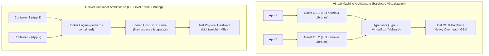
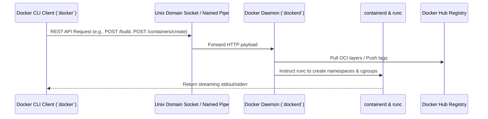
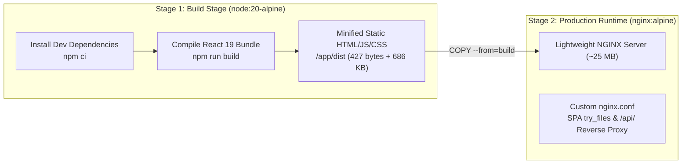

# Fresh Mart Supermarket Self-Billing System
## Unit 5: Docker Containerization & Modern Application Lifecycle Manual

> **Course Syllabus Mapping:** Postgraduate Full-Stack Technologies — Unit 5 & 5.1  
> **Target Environment:** Docker Engine v29+ · WSL 2 (Ubuntu 24.04) · Node 20 Alpine · NGINX Alpine · MongoDB 7  
> **Stack:** React 19 SPA · Express 5 API · TypeScript 7 · Docker Compose v5

---

## 1. Foundations of Containerization & Kernel Virtualization

### 1.1 Virtual Machines vs. Containers



| Dimension | Virtual Machine (VM) | Docker Container |
|---|---|---|
| **Virtualization Boundary** | Hardware-Level (Hypervisor abstraction) | OS-Level (Linux Kernel sharing) |
| **Operating System** | Requires complete Guest OS per VM | Shares Host OS Kernel (No Guest OS) |
| **Resource Footprint** | Heavyweight (Gigabytes of RAM/Disk, dedicated CPU) | Lightweight (Megabytes of RAM, high density) |
| **Startup Speed** | Minutes (Full OS boot sequence) | Milliseconds to Seconds (Instant process start) |
| **Isolation Mechanics** | Hardware isolation via VT-x/AMD-V | Process isolation via Kernel Namespaces & cgroups |

### 1.2 Underlying Linux Kernel Primitives

Docker containers are not monolithic virtual machines; a container is a standard Linux process running under specific isolation boundaries enforced by two foundational kernel primitives:

1. **Linux Namespaces (Process & View Isolation)**:
   - `PID`: Isolates process tree so the containerized application runs as `PID 1` inside its namespace.
   - `NET`: Virtual network interfaces (`eth0`), routing tables, and private port bindings.
   - `MNT`: Mount namespace isolating filesystem mount points from the host root filesystem.
   - `IPC`: Isolates Inter-Process Communication, preventing shared memory segment leakage.
   - `UTS`: Hostname isolation (`/etc/hostname`).
   - `USER`: Maps container root `UID 0` to an unprivileged non-root user UID on the host for security.
2. **Control Groups (`cgroups v2`) (Resource Allocation & Throttling)**:
   - Meters, restricts, and accounts for CPU quota, RAM memory allocation (preventing Out-Of-Memory host crashes), disk I/O, and network bandwidth.

---

## 2. Docker Engine System Architecture & Platform Setup

### 2.1 The Moby Engine Architecture & Client-Server REST API



### 2.2 Windows 10/11 WSL 2 Verification

Docker Desktop on Windows leverages the **WSL 2 backend** (Windows Subsystem for Linux v2) to execute containers natively against a real Linux kernel.

#### Step 1: Verify WSL 2 Subsystem
Open Windows PowerShell:
```powershell
wsl --list -v
```
*Expected Output:*
```
  NAME                   STATE           VERSION
* Ubuntu-24.04           Running         2
  docker-desktop         Running         2
```

#### Step 2: Diagnostic Check (`docker --version` vs `docker info`)
- `docker --version`: Checks only the local CLI client binary release string:
  ```powershell
  docker --version
  # Output: Docker version 29.8.0, build 88096ef
  ```
- `docker info`: Sends an HTTP REST call to the daemon socket (`/var/run/docker.sock` / named pipe). It returns the active storage driver (`overlay2`), cgroup driver (`systemd`), and total container counts.

---

## 3. Image Management, OCI Specs & Overlay2 Storage

### 3.1 Overlay2 Union Filesystem Layer Mechanics

Docker images are composed of immutable, read-only filesystem layers stacked by the Linux `overlay2` storage driver:

```
┌────────────────────────────────────────────────────────┐
│  Container Layer (upperdir): Read-Write [Copy-on-Write] │
├────────────────────────────────────────────────────────┤
│  Application Code (lowerdir): COPY . .                 │
├────────────────────────────────────────────────────────┤
│  Dependencies (lowerdir): RUN npm ci                   │
├────────────────────────────────────────────────────────┤
│  Base OS Image (lowerdir): FROM node:20-alpine         │
└────────────────────────────────────────────────────────┘
```

- **`lowerdir`**: Read-only stack of underlying image layers (OS, runtime, code).
- **`upperdir`**: Writable top layer where runtime file modifications and temporary session logs are written.
- **`workdir`**: Kernel working space used to prepare Copy-on-Write (CoW) transactions.
- **`merged`**: Unified virtual directory presented inside the container as root (`/`).

### 3.2 Data Persistence: Volumes vs. Bind Mounts

| Persistence Mechanism | Host System Path | Primary Supermarket Use-Case |
|---|---|---|
| **Named Volume** (`mongo-data`) | Managed by Docker (`/var/lib/docker/volumes/`) | MongoDB database persistence across container lifecycles (`/data/db`). |
| **Bind Mount** (`-v $(pwd):/app`) | User-defined absolute host path | Local frontend development hot-reloading. |

---

## 4. Multi-Stage Dockerfile Directives & Build Optimization

### 4.1 Directive Anatomy

| Directive | Layer Impact | Operational Best Practice |
|---|---|---|
| `FROM` | Base Layer | Pin specific version tag (`node:20-alpine`, `nginx:alpine`). |
| `WORKDIR` | Metadata | Creates working directory (`/app`), avoiding raw `RUN cd`. |
| `COPY` | Image Layer | Copy `package*.json` before source code to exploit layer caching. |
| `RUN` | Image Layer | Combine commands via `&&` to minimize intermediate image layers. |
| `EXPOSE` | Metadata | Documents internal listening port (`5000` for backend, `80` for frontend). |
| `USER` | Security | Drop root execution: switch to non-root `USER node` (Module 7.1). |
| `HEALTHCHECK` | Status | Periodic health probes (`wget --spider http://localhost:5000/api/health`). |
| `CMD` | Container Command | Default command overridable via CLI (`CMD ["node", "dist/server.js"]`). |

### 4.2 Multi-Stage Build: Frontend React 19 $\to$ NGINX Alpine



*Benefit*: Eliminates Node.js development servers (`vite` or `webpack-dev-server`) from production, shrinking the final image from 1.2 GB to under 30 MB.

---

## 5. Multi-Container Orchestration (`docker-compose.yml`)

The multi-container configuration connects the **MongoDB database**, **Express 5 API**, and **React 19 NGINX SPA**:

The following is an illustrative fragment. The repository-root
`docker-compose.yml` is authoritative. Copy `.env.example` to `.env` and set a
private `JWT_SECRET` before running Compose; do not commit `.env`.

```yaml
services:
  mongo-db:
    image: mongo:7-jammy
    container_name: supermarket-mongo
    ports: ["127.0.0.1:27017:27017"]
    volumes: [mongo-data:/data/db]
    networks: [supermarket-net]

  backend:
    build: { context: ./backend, dockerfile: Dockerfile }
    image: supermarket-backend:latest
    container_name: supermarket-backend
    ports: ["5000:5000"]
    environment:
      - MONGODB_URI=mongodb://mongo-db:27017/supermarket_billing
      - JWT_SECRET=${JWT_SECRET:?Set JWT_SECRET in the repository root .env file}
    depends_on: [mongo-db]
    networks: [supermarket-net]

  frontend:
    build: { context: ./frontend, dockerfile: Dockerfile }
    image: supermarket-frontend:latest
    container_name: supermarket-frontend
    ports: ["80:80"]
    depends_on: [backend]
    networks: [supermarket-net]

volumes:
  mongo-data:
    name: supermarket_mongo_data

networks:
  supermarket-net:
    driver: bridge
```

---

## 6. Hands-On Execution Guide: Pull, Build, Run, Tag & Push

### Step 1: Pull Upstream Official Base Images
Verify registry protocol and retrieve base layers into local content-addressable storage:
```bash
docker pull mongo:7-jammy
docker pull node:20-alpine
docker pull nginx:alpine
```
*Inspect local cached digests:*
```bash
docker images --digests
```

### Step 2: Build Application Images Locally
```bash
# Build Backend Image
docker build -t supermarket-backend:1.0 ./backend

# Build Frontend Multi-Stage Image
docker build -t supermarket-frontend:1.0 ./frontend
```

*Inspect layer composition and size:*
```bash
docker history supermarket-backend:1.0
docker history supermarket-frontend:1.0
```

### Step 3: Run Full Multi-Container Stack via Docker Compose
```bash
# Launch containers in detached mode
docker compose up -d

# Inspect running container status & ports
docker compose ps

# Follow live aggregated container logs
docker compose logs -f
```

### Step 4: Verify Live Endpoints
- **Frontend SPA**: Open `http://localhost` in your browser.
- **Backend API Health**: `curl http://localhost/api/health` (routed through NGINX reverse proxy).
- **Backend Direct Health**: `curl http://localhost:5000/api/health`.

### Step 5: Tag & Deploy to Docker Hub Registry
```bash
# Set your Docker Hub username
export DOCKERHUB_USERNAME="your-dockerhub-user"

# 1. Authenticate CLI client
docker login

# 2. Tag local images with registry namespace
docker tag supermarket-backend:1.0 $DOCKERHUB_USERNAME/supermarket-backend:1.0
docker tag supermarket-frontend:1.0 $DOCKERHUB_USERNAME/supermarket-frontend:1.0

# 3. Push images to Docker Hub
docker push $DOCKERHUB_USERNAME/supermarket-backend:1.0
docker push $DOCKERHUB_USERNAME/supermarket-frontend:1.0
```

### Step 6: Multi-Architecture Compilation with Docker Buildx
For heterogeneous cloud deployments (`linux/amd64` and `linux/arm64`):
```bash
# Create and activate multi-platform builder instance
docker buildx create --name supermarket-builder --use --bootstrap

# Cross-compile and publish Fat Manifest to Docker Hub
docker buildx build --platform linux/amd64,linux/arm64 \
  -t $DOCKERHUB_USERNAME/supermarket-backend:latest \
  --push ./backend

docker buildx build --platform linux/amd64,linux/arm64 \
  -t $DOCKERHUB_USERNAME/supermarket-frontend:latest \
  --push ./frontend
```

---

## 7. Diagnostic Troubleshooting Matrix

| Failure Scenario | Root Cause & Symptom | Remediation Command |
|---|---|---|
| **Daemon Socket Error** | Docker Desktop engine is not running. | Start Docker Desktop or run `sudo service docker start` in WSL. |
| **Port Conflict (`bind: address already in use`)** | Host port `5000`, `80`, or `27017` is occupied by a local process. | Terminate local process or map alternate host port in `docker-compose.yml` (`8080:80`). |
| **Immediate Exit (`PID 1`)** | Foreground application terminated or crashed. | Run `docker logs <container_name>` to inspect error traceback. |
| **Stale Layer Cache** | Docker reuses cached layers from old package lists. | Rebuild with `--no-cache`: `docker compose build --no-cache`. |
| **Registry Access Denied** | CLI not logged in or namespace mismatch. | Run `docker login` and ensure tag matches `username/repository:tag`. |

---

## 8. Teardown & Clean-up

To stop and remove all containers, networks, and persistent data:
```bash
# Stop and remove containers and network
docker compose down

# Stop and remove containers including persistent volume
docker compose down -v
```
