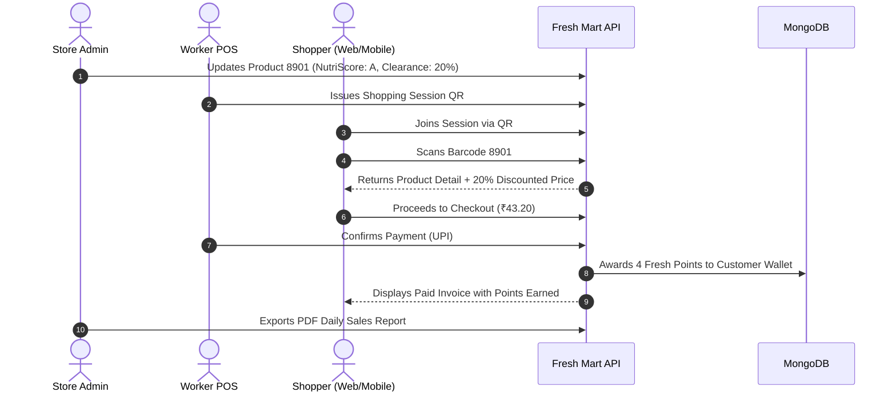

# Fresh Mart Self-Billing — Task Implementation & Manual Testing Guide

> **Document:** `docs/MANUAL_TESTING_AND_IMPLEMENTATION_GUIDE.md`  
> **Scope:** Comprehensive implementation details and step-by-step manual testing instructions for all 14 project improvements (Tasks 1–14).  
> **Verified Stack:**  
> - **Backend:** Node.js, Express 5, TypeScript (ESM), Mongoose/MongoDB, Vitest  
> - **Frontend:** React 19, Vite, TypeScript, Vitest, React Router, Context API  
> - **Mobile:** React Native, Expo, TypeScript, Zustand, React Navigation  

---

## 1. Executive Status & Implementation Matrix

| Task # | Task Title | Area | Status | Key Source Files |
| :---: | :--- | :---: | :---: | :--- |
| **1** | Extended ProductService & Full Fields API | Backend | ✅ Verified | `backend/src/services/ProductService.ts`<br/>`backend/src/controllers/ProductController.ts`<br/>`backend/src/routes/productRoutes.ts` |
| **2** | Clearance Price Calculation in Domain & Cart | Backend | ✅ Verified | `backend/src/utils/SupermarketDomain.ts`<br/>`backend/src/services/CartService.ts`<br/>`backend/src/services/CheckoutService.ts`<br/>`backend/src/models/Order.ts` |
| **3** | Admin Product Form Extended Fields UI | Web Frontend | ✅ Verified | `frontend/src/pages/AdminDashboardPage.tsx`<br/>`frontend/src/services/adminApi.ts` |
| **4** | Shopping Page Product Detail Panel & Clearance Badge | Web Frontend | ✅ Verified | `frontend/src/pages/ShoppingPage.tsx`<br/>`frontend/src/pages/ShoppingPage.css` |
| **5** | Mobile Product Detail Bottom Sheet | Mobile App | ✅ Verified | `mobile/src/components/ProductDetailSheet.tsx`<br/>`mobile/src/utils/nutriScore.ts`<br/>`mobile/src/screens/ShoppingScreen.tsx` |
| **6** | Auth Profile Endpoint & Session Cancellation API | Backend | ✅ Verified | `backend/src/models/User.ts`<br/>`backend/src/services/AuthService.ts`<br/>`backend/src/services/SessionService.ts`<br/>`backend/src/controllers/sessionController.ts` |
| **7** | React AuthContext & Protected Route Guards | Web Frontend | ✅ Verified | `frontend/src/context/AuthContext.tsx`<br/>`frontend/src/components/ProtectedRoute.tsx`<br/>`frontend/src/pages/LoginPage.tsx`<br/>`frontend/src/App.tsx` |
| **8** | Store Manager Assignment UI | Web Frontend | ✅ Verified | `frontend/src/pages/StoreManagementPage.tsx`<br/>`frontend/src/services/storeApi.ts` |
| **9** | Vision Service (Cloud Barcode OCR) | Backend / Web | ⏳ Pending | `backend/src/services/VisionService.ts`<br/>`backend/src/controllers/VisionController.ts` (Scheduled last) |
| **10** | PDF Daily Sales Report Export | Backend / Web | ✅ Verified | `backend/src/services/ReportService.ts`<br/>`backend/src/controllers/ReportController.ts`<br/>`frontend/src/pages/ReportsPage.tsx` |
| **11** | Fresh Points Loyalty / Bounty Backend Engine | Backend | ✅ Verified | `backend/src/controllers/AuthController.ts`<br/>`backend/src/routes/authRoutes.ts`<br/>`backend/src/services/AuthService.ts`<br/>`backend/src/services/CheckoutService.ts` |
| **12** | Loyalty & Bounty UI (Web & Mobile) | Web / Mobile | ✅ Verified | `frontend/src/components/DigitalBillModal.tsx`<br/>`frontend/src/pages/CustomerHistoryPage.tsx`<br/>`mobile/src/screens/ProfileScreen.tsx`<br/>`mobile/src/screens/ReceiptScreen.tsx` |
| **13** | Mobile Shared Component Library | Mobile App | ✅ Verified | `mobile/src/components/AppButton.tsx`<br/>`mobile/src/components/AppInput.tsx`<br/>`mobile/src/components/CartItemRow.tsx`<br/>`mobile/src/components/OrderCard.tsx`<br/>`mobile/src/components/NutriScoreBadge.tsx` |
| **14** | Session Cancellation UI & Real-Time Sync | Web / Mobile | ✅ Verified | `frontend/src/pages/WorkerDashboardPage.tsx`<br/>`frontend/src/services/sessionApi.ts`<br/>`mobile/src/screens/ShoppingScreen.tsx` |

---

## 2. Environment Setup & Prerequisites

Before performing manual tests, ensure the local services are running.

### 2.1 Backend Startup
```powershell
cd backend
npm install
npm run dev
```
* **API Base URL:** `http://localhost:5000`
* **Health Check:** `http://localhost:5000/api/health`

### 2.2 Web Client Startup
```powershell
cd frontend
npm install
npm run dev
```
* **Web Base URL:** `http://localhost:5173`

### 2.3 Mobile Client Startup
```powershell
cd mobile
npm install
npx expo start
```
* Press `a` for Android emulator, `i` for iOS simulator, or scan the QR code via Expo Go.

### 2.4 Pre-Configured Test Credentials
| Account Role | Email Address | Password |
| :--- | :--- | :--- |
| **Store Administrator** | `admin@freshmart.com` | `Admin@1234` |
| **Worker POS Terminal** | `worker@freshmart.com` | `Worker@1234` |
| **Customer (Self-Registered)** | Register any email on `/login` or via API | Any password ($\ge 6$ chars) |

### 2.5 Built-In Barcodes for Testing
* `8901` — Amul Taaza Fresh Toned Milk (Dairy, ₹54.00)
* `8902` — Modern White Bread (Bakery, ₹45.00)
* `8903` — Fresh Shimla Royal Apples (Produce, ₹180.00)
* `8908` — Fortune Sunlite Refined Sunflower Oil (Pantry, ₹145.00)
* `8910` — Lay's Classic Salted Potato Chips (Snacks, ₹40.00)

---

## 3. Detailed Task Implementation & Manual Testing Guide

---

### Task 1: Extended ProductService & Full Fields API

#### Technical Implementation
* **Files:** `backend/src/services/ProductService.ts`, `backend/src/controllers/ProductController.ts`, `backend/src/routes/productRoutes.ts`
* `ProductService.createProduct()` and `updateProduct()` were upgraded to explicitly persist:
  * **Wayfinding:** `aisle`, `shelf`, `bay`, `mapCoordinates` (`x`, `y`)
  * **Nutrition:** `nutriScore` (`A`–`E`), `allergens` (`string[]`), `dietaryFlags` (`string[]`), `calories`
  * **Clearance:** `expiryDate`, `clearanceDiscountPercent`
* Added input validation rejecting `clearanceDiscountPercent < 0` or `> 100` (throws HTTP 400).
* Added public route `GET /api/products/barcode/:barcode/detail` and admin route `GET /api/v1/inventory/products/:id`.

#### How to Test Manually
1. **Fetch Seed Product Detail:**
   * Open browser or run PowerShell curl:
   ```powershell
   curl.exe -s http://localhost:5000/api/products/barcode/8901/detail
   ```
   * Or through Docker NGINX proxy:
   ```powershell
   curl.exe -s http://localhost/api/products/barcode/8901/detail
   ```
   * **Expected Result:** JSON response with `success: true` containing `nutriScore: "A"`, `allergens: ["Milk"]`, `aisle: "Aisle 3 - Dairy"`, `calories: 58`.
2. **Test Validation Boundary (Negative Test):**
   * Attempt to create a product with invalid clearance percentage (120%):
   ```powershell
   curl.exe -s -X POST http://localhost:5000/api/products `
     -H "Content-Type: application/json" `
     -d '{"barcode":"9999","name":"Test Error","price":100,"stockQty":10,"clearanceDiscountPercent":120}'
   ```
   * **Expected Result:** HTTP 400 with message `"Clearance discount must be between 0 and 100."`

---

### Task 2: Clearance Price Calculation in Domain & Cart

#### Technical Implementation
* **Files:** `backend/src/utils/SupermarketDomain.ts`, `backend/src/services/CartService.ts`, `backend/src/services/CheckoutService.ts`, `backend/src/models/Order.ts`
* `BarcodeEngine.effectivePrice(product)` applies clearance markdown **only** when:
  1. `clearanceDiscountPercent > 0`
  2. `expiryDate` is within 7 days from now (`CLEARANCE_WINDOW_DAYS = 7`)
* When eligible, unit price becomes `price * (1 - clearanceDiscountPercent / 100)`.
* In `CheckoutService.processCheckout()`, line items snapshot `clearanceApplied: true` and line totals reflect the discounted price.

#### How to Test Manually
1. **Create an active clearance product via Admin or API:**
   * Barcode: `8801`, Base Price: `₹100`, `clearanceDiscountPercent: 20`, `expiryDate`: 2 days in the future.
2. **Add to Cart & Checkout:**
   * In a shopping session, add barcode `8801`.
   * Check Cart response: `item.price` is `80.00` (20% off ₹100).
   * Proceed to checkout: Order bill shows item subtotal `₹80.00`, and `clearanceApplied` is `true`.
3. **Verify Window Boundary (Non-Clearance):**
   * Set `expiryDate` 15 days in the future with `clearanceDiscountPercent: 20`.
   * Add to cart: Price remains full `₹100.00` because the product is outside the 7-day clearance window.

---

### Task 3: Admin Product Form Extended Fields UI (Web)

#### Technical Implementation
* **Files:** `frontend/src/pages/AdminDashboardPage.tsx`, `frontend/src/services/adminApi.ts`
* Enhanced modal form for Add/Edit Product in the Admin Dashboard:
  * Dropdown selector for **Nutri-Score** (`A`, `B`, `C`, `D`, `E`).
  * Text inputs for **Aisle**, **Shelf**, and number input for **Bay**.
  * Comma-separated inputs for **Allergens** (e.g. `Dairy, Peanuts`) and **Dietary Flags** (e.g. `Vegetarian, Gluten-Free`) that automatically parse to arrays.
  * Date picker for **Expiry Date** and numeric stepper for **Clearance Discount %**.
  * Product inventory table displays a prominent **"CLEARANCE X%"** badge when markdown is active.

#### How to Test Manually
1. Open `http://localhost:5173/login` in your browser.
2. Log in with `admin@freshmart.com` / `Admin@1234`.
3. In the sidebar, navigate to **Inventory / Products**.
4. Click **"+ Add New Product"**.
5. Fill in:
   * Name: `Greek Yogurt Organic`
   * Barcode: `7701`
   * Price: `120`, Stock: `50`
   * Aisle: `Aisle 3 - Dairy`, Shelf: `Shelf C`, Bay: `2`
   * Nutri-Score: `A`
   * Allergens: `Milk`
   * Expiry Date: Choose tomorrow's date
   * Clearance %: `25`
6. Click **Save Product**.
7. **Expected Result:** The table updates with the new product showing an orange `CLEARANCE 25%` badge and location `Aisle 3 - Dairy · Shelf C`.

---

### Task 4: Shopping Page Product Detail Panel & Clearance Badge (Web)

#### Technical Implementation
* **Files:** `frontend/src/pages/ShoppingPage.tsx`, `frontend/src/pages/ShoppingPage.css`
* Upon scanning or typing a barcode, the web shopping terminal fires a non-blocking request to `GET /api/products/:barcode/detail`.
* Renders a sliding **Product Detail Card**:
  * Color-coded Nutri-Score pill (Green `A` to Red `E`).
  * Calories per serving badge.
  * Allergen badges with amber warning colors.
  * Store location tags (`Aisle · Shelf · Bay`).
  * Glowing clearance ribbon showing original vs discounted price when markdown is active.
  * Auto-dismisses after 4 seconds to maintain fast scanning cadence.

#### How to Test Manually
1. Join or start a shopping session on `http://localhost:5173/join`.
2. On the Shopping POS page, enter barcode `8901` (Amul Milk) in the barcode field and press Enter.
3. **Expected Result:**
   * A beep sound plays.
   * Amul Milk is added to the cart table.
   * A card slides in on top showing:
     * `Nutri-Score: A` in green.
     * `Aisle 3 - Dairy · Shelf B · Bay 2`.
     * `Allergens: Milk`.
     * Closes automatically after 4 seconds.

---

### Task 5: Mobile Shopping Screen Product Detail Bottom Sheet

#### Technical Implementation
* **Files:** `mobile/src/components/ProductDetailSheet.tsx`, `mobile/src/utils/nutriScore.ts`, `mobile/src/screens/ShoppingScreen.tsx`
* Native mobile `Modal` presenting an animated bottom sheet after barcode capture.
* Displays Nutri-Score badge via the shared `NutriScoreBadge` component, allergen tags, calorie count, and shelf location.
* Provides a quick "Add to Cart" or "Dismiss" action.

#### How to Test Manually
1. Open Fresh Mart on Expo mobile app.
2. Join a shopping session.
3. Scan or enter barcode `8903` (Fresh Shimla Apples).
4. **Expected Result:** A smooth bottom sheet animates up from the bottom of the screen displaying:
   * Apple image and title.
   * Grade `B` Nutri-Score badge.
   * Dietary flags: `Vegetarian`, `Vegan`.
   * Shelf location: `Aisle 1 - Produce · Shelf A`.

---

### Task 6: Backend Auth: Profile Endpoint & Session Cancellation API

#### Technical Implementation
* **Files:** `backend/src/models/User.ts`, `backend/src/services/AuthService.ts`, `backend/src/services/SessionService.ts`, `backend/src/controllers/sessionController.ts`, `backend/src/routes/sessionRoutes.ts`
* `User` schema contains `phone` and `dietaryPreferences` (`allergens: string[]`, `diet: string[]`).
* Added `PATCH /api/v1/auth/profile` allowing users to update their personal details and dietary filters.
* Added `DELETE /api/sessions/:code` with role guards supporting `admin`, `worker`, and `customer`.
* `SessionService.cancelSession()` sets session status to `CANCELLED`, records the acting user's role in the audit log, and broadcasts `SESSION_CANCELLED` over the Server-Sent Events (SSE) stream.

#### How to Test Manually
1. **Update User Profile via API:**
   * Obtain JWT by logging in as a customer:
   ```powershell
   $login = curl.exe -s -X POST http://localhost:5000/api/v1/auth/login `
     -H "Content-Type: application/json" `
     -d '{"email":"worker@freshmart.com","password":"Worker@1234"}' | ConvertFrom-Json
   $token = $login.data.token
   ```
   * Send profile patch:
   ```powershell
   curl.exe -s -X PATCH http://localhost:5000/api/v1/auth/profile `
     -H "Authorization: Bearer $token" `
     -H "Content-Type: application/json" `
     -d '{"phone":"9876543210","dietaryPreferences":{"allergens":["Peanuts"],"diet":["Vegetarian"]}}'
   ```
   * **Expected Result:** Returns updated user profile with phone `9876543210` and allergen `["Peanuts"]`.

---

### Task 7: React AuthContext & Protected Route Guards (Web)

#### Technical Implementation
* **Files:** `frontend/src/context/AuthContext.tsx`, `frontend/src/components/ProtectedRoute.tsx`, `frontend/src/pages/LoginPage.tsx`, `frontend/src/App.tsx`
* `AuthContext` provides `{ user, token, isAuthenticated, login, logout }` backed by `sessionStorage`.
* `ProtectedRoute` guards `/admin`, `/inventory`, `/stores`, and `/reports` requiring `admin` role; guards `/worker` requiring `worker` role.
* Direct URL navigation to protected pages redirects unauthorized visitors to `/login?redirect=...`.
* Login page automatically routes users based on their role:
  * Admin $\rightarrow$ `/admin`
  * Worker $\rightarrow$ `/worker`
  * Customer $\rightarrow$ `/join`

#### How to Test Manually
1. Open a new Incognito / Private browser tab.
2. Directly navigate to `http://localhost:5173/admin`.
3. **Expected Result:** Instantly redirected to `http://localhost:5173/login?redirect=%2Fadmin`.
4. Enter `worker@freshmart.com` / `Worker@1234` and click Sign In.
5. **Expected Result:** Worker role does not have admin permission; redirected safely to `/worker`.
6. Click **Log Out** in the navigation bar; session clears and redirects to `/login`.

---

### Task 8: Store Manager Assignment UI (Web)

#### Technical Implementation
* **Files:** `frontend/src/pages/StoreManagementPage.tsx`, `frontend/src/services/storeApi.ts`
* In the Store Management console, each store card displays the assigned manager's name.
* Administrators see an **"Assign Manager"** / **"Change Manager"** button that opens a selection modal listing registered staff workers.
* Calls `POST /api/v1/stores/:id/assign-manager` and updates the store state reactively.

#### How to Test Manually
1. Log in as `admin@freshmart.com` at `http://localhost:5173/login`.
2. Navigate to **Stores** (`/stores`).
3. On "Fresh Mart Main Branch", click **"Assign Manager"**.
4. In the dialog, select a worker from the dropdown and click **Confirm Assignment**.
5. **Expected Result:** A success toast appears, and the store card immediately displays `Manager: [Selected Worker Name]`.

---

### Task 9: Vision Service (Cloud Barcode OCR) — Status & Architecture

#### Status Note
* As specified in `newly-improvement.md`, Task 9 is intentionally planned as the final external integration task.
* **Architecture:** Supports dual providers (`VISION_PROVIDER=google` using `@google-cloud/vision` and `VISION_PROVIDER=aws` using `@aws-sdk/client-rekognition`).
* `GET /api/v1/vision/status` exposes `{ enabled: boolean, provider: string }`.
* When `VISION_API_ENABLED=false` (default safe mode), the UI gracefully hides the cloud scan button and utilizes client-side camera barcode scanning.

---

### Task 10: PDF Daily Sales Report Export

#### Technical Implementation
* **Files:** `backend/src/services/ReportService.ts`, `backend/src/controllers/ReportController.ts`, `frontend/src/pages/ReportsPage.tsx`, `frontend/src/services/reportApi.ts`
* Backend uses `pdfkit` to build an A4 formatted document containing:
  * Store header, report generation timestamp, and selected date range.
  * Executive KPI metric cards (Total Gross Revenue, Net Paid Orders, Collected GST Tax, Average Order Value).
  * Tabular itemization of daily sales breakdown.
  * Category revenue distribution table and top peak shopping hours.
* Endpoint `GET /api/v1/reports/export/pdf` streams the binary buffer with `Content-Type: application/pdf`.
* Frontend adds an **"Export PDF"** button alongside the CSV export.

#### How to Test Manually
1. Log in as Admin at `http://localhost:5173/login`.
2. Go to **Reports** (`/reports`).
3. Select a date range (e.g. Last 30 Days).
4. Click the purple **"Export PDF"** button.
5. **Expected Result:**
   * Browser triggers an immediate file download named `freshmart-sales-report-[date].pdf`.
   * Open the PDF: It contains a professional multi-section report with tables, headers, and KPI boxes.

---

### Task 11: Fresh Points Loyalty / Bounty Backend Engine

#### Technical Implementation
* **Files:** `backend/src/controllers/AuthController.ts`, `backend/src/routes/authRoutes.ts`, `backend/src/services/AuthService.ts`, `backend/src/services/CheckoutService.ts`
* **Earning Logic:** In `CheckoutService.confirmPayment()`, when `order.customerId` exists:
  $$\text{Fresh Points Earned} = \left\lfloor \frac{\text{Order Total Amount}}{10} \right\rfloor$$
  $$\text{Wallet Credit Added} = \text{Fresh Points} \times ₹0.50$$
* Idempotency protection prevents double-awarding if `confirmPayment()` is retried.
* **Redemption Endpoint:** `POST /api/v1/auth/redeem-bounty` (`customer` role only):
  * Debits requested points and wallet balance (floor 0).
  * Writes an immutable audit entry with action `BOUNTY_REDEEMED`.

#### How to Test Manually
1. Log in as a customer via API or register a new customer account.
2. Complete a payment for an order totaling `₹500.00`.
3. Check customer profile:
   ```powershell
   curl.exe -s http://localhost:5000/api/v1/auth/profile -H "Authorization: Bearer $customerToken"
   ```
   * **Expected Result:** `bountyPoints: 50`, `bountyWalletBalance: 25.0`.
4. Redeem 20 points:
   ```powershell
   curl.exe -s -X POST http://localhost:5000/api/v1/auth/redeem-bounty `
     -H "Authorization: Bearer $customerToken" `
     -H "Content-Type: application/json" `
     -d '{"pointsToRedeem": 20}'
   ```
   * **Expected Result:** Returns `bountyPoints: 30`, `bountyWalletBalance: 15.0`.
5. Attempt to redeem 100 points (Negative Test):
   * **Expected Result:** HTTP 400 with message `"Insufficient Fresh Points. You have 30 points but tried to redeem 100."`

---

### Task 12: Loyalty & Bounty UI (Web & Mobile)

#### Technical Implementation
* **Files:** `frontend/src/components/DigitalBillModal.tsx`, `frontend/src/pages/CustomerHistoryPage.tsx`, `mobile/src/screens/ProfileScreen.tsx`, `mobile/src/screens/ReceiptScreen.tsx`
* **Web UI:**
  * `CustomerHistoryPage` features a **Fresh Points Wallet Banner** at the top displaying current points balance and rupee redemption value.
  * `DigitalBillModal` renders a golden celebration badge: *"🎉 You earned X Fresh Points on this order!"*.
* **Mobile UI:**
  * New dedicated `ProfileScreen` accessible from header icon across `ReceiptScreen` and `HistoryScreen`.
  * Features quick-redeem chips (`10 pts`, `25 pts`, `50 pts`) and real-time wallet debit updates.

#### How to Test Manually
1. On Web: Log in as customer, visit **Purchase History** (`/history`).
2. **Expected Result:** Top of page displays the **Fresh Points Card** with your total points and cash wallet equivalent.
3. Click on any paid order to open the digital invoice.
4. **Expected Result:** Invoice displays the **Points Earned** badge below the tax total.
5. On Mobile: Tap the 👤 avatar icon in the navigation bar to open the **Profile & Rewards Screen**.
6. Tap the **"Redeem 10 Pts"** chip; the balance updates immediately.

---

### Task 13: Mobile Shared Component Library

#### Technical Implementation
* **Files:** `mobile/src/components/AppButton.tsx`, `mobile/src/components/AppInput.tsx`, `mobile/src/components/CartItemRow.tsx`, `mobile/src/components/OrderCard.tsx`, `mobile/src/components/NutriScoreBadge.tsx`, `mobile/src/theme/colors.ts`
* Consolidated scattered inline styles and duplicate button/input markup across screens into reusable primitives:
  * `AppButton`: Supports `primary`, `secondary`, `danger` variants and integrated loading indicator.
  * `AppInput`: Unified floating label, helper text, and validation error styling.
  * `CartItemRow`: Supports editable stepper mode for shopping and static mode for receipt review.
  * `NutriScoreBadge`: Canonical color and typography for nutritional grades.
  * `OrderCard`: Reusable order history item with status chip.

#### How to Test Manually
1. Open the mobile app and navigate through `ShoppingScreen`, `CartReviewScreen`, and `HistoryScreen`.
2. Verify visual consistency:
   * Stepper buttons (`+` and `-`) have smooth touch response and consistent padding.
   * Status tags (`PAID`, `PENDING`, `CANCELLED`) display uniform colors.
   * Nutri-Score badge displays cleanly on the product detail bottom sheet.

---

### Task 14: Session Cancellation UI & Real-Time Sync

#### Technical Implementation
* **Files:** `frontend/src/pages/WorkerDashboardPage.tsx`, `frontend/src/services/sessionApi.ts`, `backend/src/routes/sessionRoutes.ts`, `mobile/src/screens/ShoppingScreen.tsx`
* **Worker POS:** Active session rows display a red **"Cancel Session"** button. Clicking triggers a confirmation prompt, calls `DELETE /api/sessions/:code`, and removes the row with an alert toast.
* **Real-Time Customer Ejection:**
  * When a session is cancelled, `SessionSyncService` broadcasts a `SESSION_CANCELLED` SSE event.
  * Web and Mobile shopping screens subscribe to this stream:
    * Upon receiving `SESSION_CANCELLED`, the customer app alerts the user (*"This shopping session was cancelled by store staff"*), clears the active cart and session cache, and returns to the scanner/join screen.
* **Customer Voluntary Exit:**
  * Mobile "Leave Session" header button sends `DELETE /api/sessions/:code` with authenticated customer role and gracefully resets screen state.

#### How to Test Manually (End-to-End Two-Device / Two-Window Test)
1. **Window 1 (Worker POS):**
   * Log in as worker on `http://localhost:5173/login`.
   * Click **"Generate Shopping QR"**.
   * Note the created 8-character session code (e.g. `c4b18f02`).
2. **Window 2 (Customer):**
   * Open `http://localhost:5173/join` in an Incognito window.
   * Join using the session code.
   * Add barcode `8901` to cart. The shopping terminal is now active.
3. **Trigger Cancellation from Worker POS (Window 1):**
   * In the Worker Dashboard active sessions table, locate the row and click **"Cancel"**.
   * Confirm the browser dialog.
4. **Observe Customer Terminal (Window 2):**
   * **Expected Result:** Within 1–2 seconds, the customer screen displays an alert: *"Session has been cancelled"*, closes the active cart, and redirects back to the Session Join screen.
   * The Worker POS table marks the session as removed/cancelled.

---

## 4. Automated Test Commands Reference

Run the automated suites to verify test assertions across all packages:

```powershell
# 1. Backend Integration & Domain Tests
cd backend
npx vitest run src/tests/ProductService.test.ts      # Task 1: Extended fields & validations
npx vitest run src/tests/SupermarketDomain.test.ts   # Task 2: Clearance effective price
npx vitest run src/tests/SessionService.test.ts      # Task 6 & 14: Session cancel & audit
npx vitest run src/tests/BountyService.test.ts       # Task 11: Fresh Points loyalty rewards
npx tsc --noEmit                                    # Typecheck full backend

# 2. Frontend Unit & Type Tests
cd ../frontend
npm run typecheck                                   # Full TypeScript project check
npx vitest run src/services/sessionApi.test.ts       # Task 14: Session cancellation API client

# 3. Mobile TypeScript Verification
cd ../mobile
npm run typecheck                                   # Full mobile project typecheck
```

---

## 5. Comprehensive End-to-End Walkthrough Script

Follow this script to demonstrate the entire ecosystem from start to finish:



1. **Step 1 (Catalog Preparation):** Admin edits Product `8901` in `/admin` with `clearanceDiscountPercent: 20` and expiry date tomorrow.
2. **Step 2 (Session Creation):** Worker creates a new shopping session at `/worker`.
3. **Step 3 (Customer Shopping):** Customer joins session on `/join`, scans `8901`. Notice the Nutri-Score card, the discounted line item, and checkout total.
4. **Step 4 (Settlement & Bounty):** Worker confirms payment. Customer receipt shows paid invoice and newly awarded Fresh Points.
5. **Step 5 (Report Generation):** Admin navigates to `/reports` and downloads the daily PDF sales summary.
