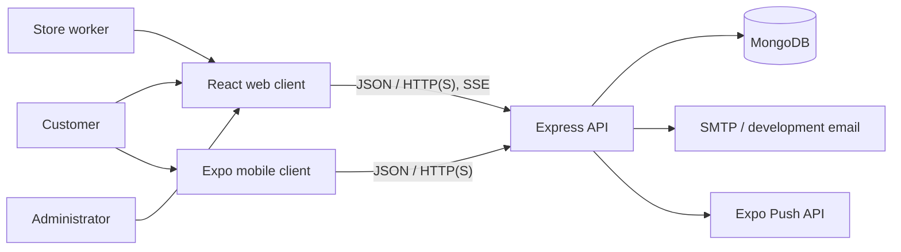
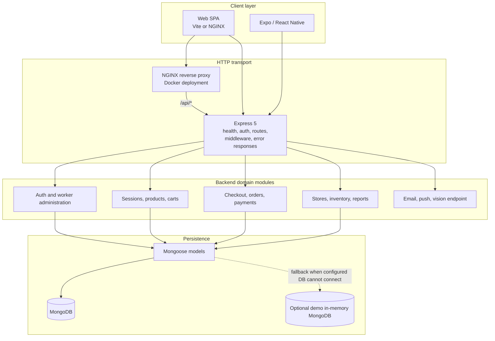
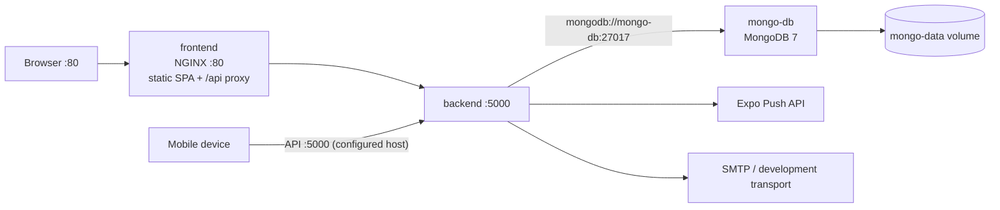
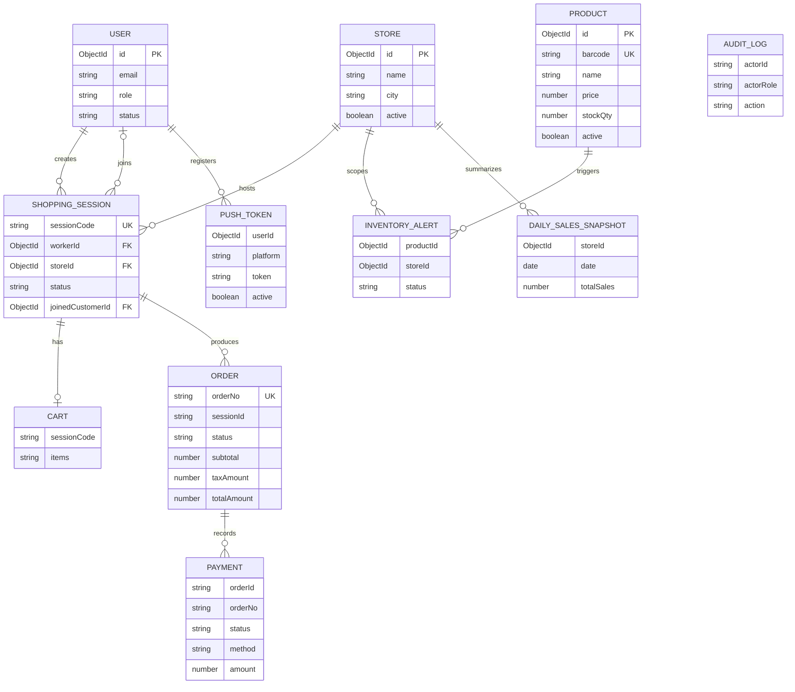

# Fresh Mart — Full Application Report

> **Purpose:** A source-oriented overview of the complete Fresh Mart system:
> customer web and mobile clients, worker and administrator workflows, API,
> data, integrations, deployment, and operational boundaries.
>
> **Scope note:** This report describes the checked-in implementation, not a
> production-readiness certification. Payment settlement is confirmed by a
> worker; an external payment processor is not integrated. The optional cloud
> vision barcode endpoint is a stub. See [Known boundaries](#12-known-boundaries-and-next-steps).

## Contents

1. [Executive summary](#1-executive-summary)
2. [Product scope and actors](#2-product-scope-and-actors)
3. [System context and architecture](#3-system-context-and-architecture)
4. [Client applications](#4-client-applications)
5. [Backend capabilities and API surface](#5-backend-capabilities-and-api-surface)
6. [End-to-end shopping and settlement](#6-end-to-end-shopping-and-settlement)
7. [Data and domain model](#7-data-and-domain-model)
8. [Integrations and background work](#8-integrations-and-background-work)
9. [Security and privacy](#9-security-and-privacy)
10. [Deployment and configuration](#10-deployment-and-configuration)
11. [Verification and maintenance](#11-verification-and-maintenance)
12. [Known boundaries and next steps](#12-known-boundaries-and-next-steps)

## 1. Executive summary

Fresh Mart is a self-billing and store-operations application for supermarket
checkout. A customer joins a worker-issued shopping session, scans products,
reviews a server-backed cart, and receives an order receipt. A worker manages
sessions and confirms payment at the counter. Administrators manage workers,
stores, inventory, and reporting.

The repository contains three application packages:

| Package | Role | Main technologies |
| --- | --- | --- |
| `frontend/` | Browser experience for customers, workers, and administrators | React 19, TypeScript, Vite; optional Webpack build |
| `mobile/` | Customer mobile app | Expo, React Native, TypeScript, React Navigation |
| `backend/` | REST API, domain rules, persistence, and integrations | Node.js, Express 5, TypeScript, Mongoose |

MongoDB stores users, catalog and store data, sessions, carts, orders, payments,
audit entries, alerts, snapshots, and push tokens. Docker Compose adds MongoDB,
the API, and an NGINX-hosted production web build.

## 2. Product scope and actors

### Customer

- Registers or signs in, scans/enters a worker-issued session QR/code, and joins
  the active shopping session.
- Scans shelf barcodes with the web camera scanner or native mobile camera;
  manual barcode entry is also available.
- Adds products, edits quantities, removes items, and reviews checkout totals.
- Views receipts and personal order history. The web app can print the digital
  bill; the API can send a receipt email.

### Worker

- Uses the web POS dashboard to issue shopping sessions and display QR codes.
- Monitors session/cart/order events and confirms the counter payment using a
  supported payment method (UPI, cash, or card).
- The application records a staff-confirmed payment; it does not charge a card
  or call a UPI payment provider.

### Administrator

- Manages worker accounts and their active/disabled status.
- Manages store and product/inventory data, views reports and dashboard
  information, and reviews audit records where exposed by the UI/API.

### Scope boundaries

This is an application foundation for assisted self-checkout, not a complete
retail payment terminal. Tax rules, product availability, stock, checkout state,
and persisted order details are API-owned. Clients display and submit user
actions; they are not authoritative for price or payment confirmation.

## 3. System context and architecture

### 3.1 Context



### 3.2 Application layers



The backend uses a route/controller/service/model separation. Express routers
map HTTP operations to controllers; service classes implement business
workflows; Mongoose schemas define persistence. Shared domain utilities include
GST/tax calculation, stock status, barcode checks, and session/order helpers.

### 3.3 Container deployment topology



Compose includes MongoDB, backend, and web frontend. MongoDB's host port is
loopback-bound for local development. The mobile app is not a Compose service.
For deployment beyond a developer machine, add TLS, network controls, managed
secrets, durable backups, monitoring, and an explicit operational plan.

## 4. Client applications

### 4.1 Web (`frontend/`)

The React single-page app provides:

- Login/registration and customer history.
- QR/session joining and shopping/cart interactions.
- A camera barcode scanner based on `@zxing/browser`, plus manual product
  entry and scan feedback.
- Worker POS/session management and payment confirmation.
- Administrator pages for dashboards, inventory, store management, and
  reports.
- Digital bill presentation with browser printing.

API helper modules are separated by concerns including auth, cart, checkout,
sessions, inventory, reports, stores, and vision.

### 4.2 Mobile (`mobile/`)

The Expo/React Native app is a customer client with login/registration,
QR scanning and manual session-code entry, shopping, cart review, pending
payment, receipt, and purchase-history screens. It uses:

- Expo Camera for QR and supported product barcode scanning.
- `expo-secure-store` for the authentication token.
- React Navigation deep links using the `freshmart://join/:code` scheme.
- A configured Expo push-notification integration.
- `EXPO_PUBLIC_API_URL` to select an API reachable by the device.

The mobile app does not replace the web worker/admin consoles.

## 5. Backend capabilities and API surface

The API exposes a health endpoint at `GET /api/health`. Current business route
groups are mounted under `/api/v1`:

| Route prefix/group | Responsibility |
| --- | --- |
| `/auth` | Customer registration, login, logout, and identity |
| `/workers` | Worker administration |
| `/admin` | Administrative operations and dashboard information |
| `/stores` | Store management |
| `/inventory` | Catalog and stock management |
| `/reports` | Sales and operational reporting |
| `/vision` | Image/barcode endpoint (currently a stub) |
| `/push` | Mobile push-token registration and notification operations |
| Checkout routes | Checkout creation, payment confirmation, orders, receipts |

Older auth, session, product, and cart paths remain mounted outside the versioned
prefix for compatibility. Consult `backend/src/routes/` for the definitive
route definitions; the implementation may evolve independently of this summary.

API responsibilities include role checks, product/stock validation, cart
updates, order snapshot creation, tax calculation, payment state updates,
inventory alerts, sales snapshots, and audit logging.

## 6. End-to-end shopping and settlement

```mermaid
sequenceDiagram
    actor Worker
    actor Customer
    participant Client as Web or mobile client
    participant API as Express API
    participant DB as MongoDB
    Worker->>API: Create shopping session
    API->>DB: Save session and associate store/worker
    API-->>Worker: Return session code / QR data
    Customer->>Client: Scan QR or enter code
    Client->>API: Join session
    API->>DB: Associate customer and active session
    loop Scan items and manage cart
        Customer->>Client: Scan barcode or enter code
        Client->>API: Add/update/remove cart item
        API->>DB: Validate catalog and stock; persist cart
        API-->>Client: Updated cart and totals
    end
    Customer->>Client: Request checkout
    Client->>API: Checkout for session
    API->>DB: Revalidate products and available stock
    API->>DB: Save order item snapshots and pending payment
    API-->>Client: Pending bill and payment details
    API-->>Worker: Session event stream update
    Worker->>API: Confirm counter payment
    API->>DB: Guard stock decrement; mark order/payment settled
    API-->>Client: Receipt / updated order state
```

Checkout uses current catalog prices and stock rather than trusting a client
cart total. It calculates GST in the domain layer, creates an order with
item-level snapshots, and creates a payment record. A worker confirmation
performs guarded stock decrements and records settlement. Repeated requests
reuse the existing pending/paid order where the service supports that path.

Session updates can be streamed using Server-Sent Events. The current sync
service stores stream connections in process memory; it is not a distributed
event bus.

## 7. Data and domain model

MongoDB collections are defined by Mongoose models under `backend/src/models/`.
The central entities and references are summarized below; some references are
stored as string identifiers rather than MongoDB foreign-key constraints.



Order line items contain denormalized product details (barcode, name, price,
quantity, and line total) so that a receipt reflects the billed values even if
the catalog later changes. The order also stores customer/store details,
subtotal, tax, total, status, payment method, and timestamps.

The tax helper currently applies a default 5% rate and splits it into CGST and
SGST amounts. Confirm local tax policy before using the application for real
transactions.

## 8. Integrations and background work

| Capability | Current behavior |
| --- | --- |
| MongoDB | Persistent store when reachable; configured startup fallback can use an in-memory MongoDB instance for demonstrations. |
| Email | Nodemailer supports configured SMTP. Development tries Ethereal; offline fallback uses JSON transport, which does not deliver email. |
| Push | API stores Expo device tokens and sends payloads to the Expo Push API. |
| Session events | Server-Sent Events broadcast in-process cart, checkout, and payment events. |
| Vision API | Route/service exists, but cloud barcode decoding is explicitly unimplemented. |
| Scheduled reports | API process schedules daily sales snapshots at 00:05. |

The in-memory database, local event streams, and in-process cron job are
single-instance/demo-oriented. Production operation requires durable MongoDB,
deduplicated scheduling, and a shared event/notification strategy if multiple
API replicas are used.

## 9. Security and privacy

- Passwords are hashed with `bcryptjs`; the API issues signed JWTs and checks
  user roles in middleware.
- The web client currently keeps its auth token in `sessionStorage`; the mobile
  client uses Expo SecureStore. Do not treat browser storage as equivalent to
  an HttpOnly-only session design.
- The JWT signing secret must be unique, private, and supplied through the
  runtime environment. Never commit `.env` files, access tokens, SMTP
  credentials, or production keys.
- The root `.gitignore` excludes `.env`/`.env.*` files (while allowing the
  placeholder `.env.example`), dependency folders, build output, logs, and Expo
  local state.
- Docker Compose requires an explicit `JWT_SECRET`; MongoDB's published host
  port is restricted to loopback for local use.
- The API applies Helmet, an authentication-route rate limiter, and role-based
  access checks. Review CORS, cookie policy, TLS termination, request
  validation, and production logging before external deployment.
- Development seed accounts require local environment passwords. Production
  startup skips those accounts. Provision a production administrator through a
  controlled deployment procedure.
- Customer names, emails, purchase history, device tokens, and audit data are
  personal or operational data. Define retention, access, and backup policies
  before production use.

## 10. Deployment and configuration

### Local

Each package is installed independently with `npm ci`. The API uses
`backend/.env`; the web development server runs separately; mobile uses
`EXPO_PUBLIC_API_URL` when its inferred device host is not appropriate.

### Docker Compose

The Compose services are MongoDB 7, the TypeScript API container, and the
NGINX-hosted web build. Copy root `.env.example` to `.env`, replace the
placeholder `JWT_SECRET`, then run `docker compose up --build`. The mobile
application is not containerized by this Compose file.

Detailed commands and the environment variable table are in the
[deployment guide](./07-deployment-and-operations-guide.md).

### Important deployment expectations

- Do not expose MongoDB directly to the public internet.
- Use HTTPS, a strong secret manager, and environment-specific secrets.
- Configure a durable MongoDB service and backups.
- Configure SMTP intentionally; default development transports do not guarantee
  delivery.
- Configure the correct mobile API URL and Expo notification credentials.
- Use a shared scheduler/coordination mechanism if running more than one API
  instance.

## 11. Verification and maintenance

Available checks from the package scripts:

| Package | Command | Purpose |
| --- | --- | --- |
| Backend | `npm test` | Run Vitest unit tests |
| Backend | `npm run build` | Compile TypeScript to `dist/` |
| Frontend | `npm run typecheck` | TypeScript project check |
| Frontend | `npm run build` | Typecheck and create Vite production output |
| Frontend | `npm run build:webpack` | Optional Webpack production build |
| Frontend | `npm run lint` | ESLint |
| Mobile | `npm run typecheck` | TypeScript check |

Tests/builds should be run in the package directory after dependencies are
installed. This report intentionally makes no claim that a specific run has
passed; use current command output as the source of truth.

## 12. Known boundaries and next steps

1. **Payments:** Integrate a real provider and verified payment callbacks before
   representing card/UPI transactions as remotely settled.
2. **Cloud vision:** Implement and test the currently stubbed vision decode
   integration or remove the unused endpoint/feature flags.
3. **Production auth:** Provision production administrator accounts through a
   controlled process, and review browser token storage, cookie behavior,
   CORS, and account lifecycle.
4. **Scaling:** Move session events to a shared broker and coordinate nightly
   jobs across API replicas.
5. **Reliability:** Add database backup/restore procedures, operational
   monitoring, and tests for the complete customer-to-payment workflow.
6. **Tax and compliance:** Confirm jurisdiction-specific tax rules, invoice
   requirements, retention, and privacy controls with the responsible business
   owner.

These items are product and operational follow-ups, not claims that the current
application already implements them.
