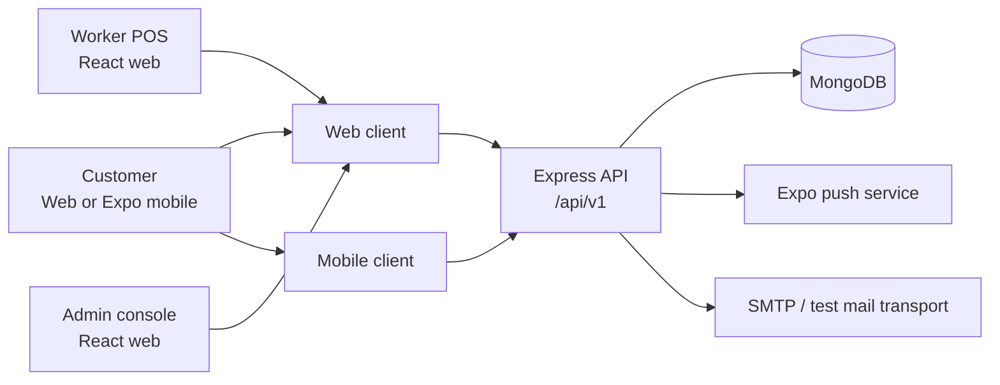

# Fresh Mart documentation

Fresh Mart is a supermarket self-billing system with a React web app, an Expo
mobile app, a TypeScript/Express API, and MongoDB. This folder's report is the
cross-system reference; the smaller guides provide focused implementation
details.

## Start here

- [Full application report](./PROJECT_REPORT.md) — scope, architecture, clients,
  business workflows, data, integrations, security, deployment, testing, and
  current limitations.
- [Deployment and operations](./07-deployment-and-operations-guide.md) — local
  development, Docker Compose, mobile configuration, and verification commands.

## Focused engineering guides

| Guide | Subject |
| --- | --- |
| [Architecture](./01-architecture-overview.md) | Components and application layers |
| [Object-oriented design](./02-object-oriented-design.md) | Controllers, services, DTOs, and design patterns |
| [Data and domain models](./03-database-and-domain-models.md) | MongoDB collections and business entities |
| [API specification](./04-api-specification.md) | HTTP route groups and API conventions |
| [Security](./05-security-and-authorization.md) | Authentication, access control, and safe operation |
| [Workflows](./06-system-workflows-and-dashboards.md) | Customer, worker, and administrator journeys |
| [Mobile application](./11-mobile-application-guide.md) | Expo client and device capabilities |

The TypeScript and Webpack guides are educational references rather than
authoritative descriptions of application behavior. For current behavior,
prefer the full application report and the source code.

## System at a glance

For the end-to-end component and deployment views, see the Mermaid diagrams in
the [full application report](./PROJECT_REPORT.md).
